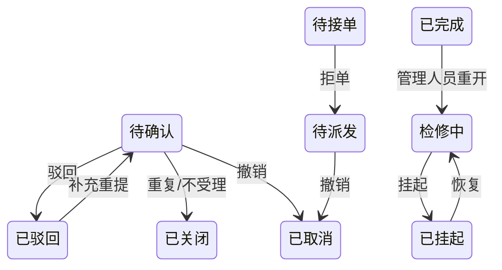
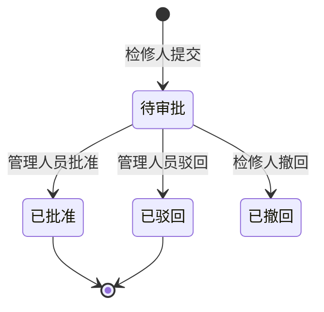
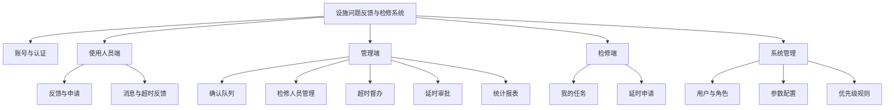
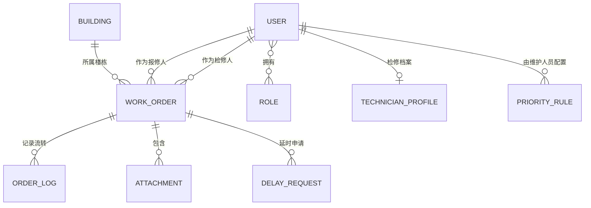
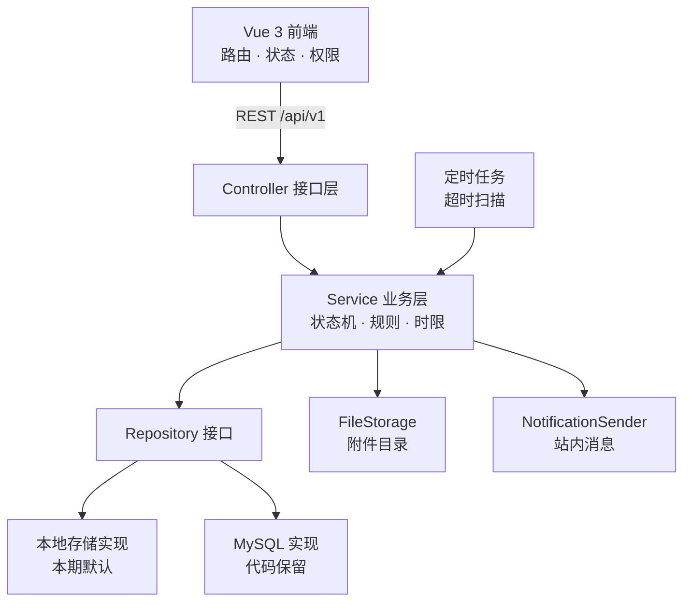

# 设施问题反馈与检修系统

## 业 务 分 析 报 告

*Business Analysis Report*

---

| 项目 | 内容 |
|---|---|
| 课程名称 | 软件工程 |
| 项目名称 | 设施问题反馈与检修系统 |
| 项目小组 | 第 ______ 组 |
| 小组成员 | ________________________ |
| 指导教师 | ________________________ |
| 编制日期 | 2026 年 11 月 |

---

## 文档信息

| 项目 | 内容 |
|---|---|
| 文档名称 | 《设施问题反馈与检修系统 业务分析报告》 |
| 文档编号 | SWE-BA-2026-001 |
| 版本 | V1.7 |
| 密级 | 内部（课程作业） |
| 编制 | 项目小组 |
| 审核 | — |
| 编制日期 | 2026 年 11 月 20 日 |
| 适用范围 | 本项目需求分析、概要设计与后续开发的依据 |

**修订记录**

| 版本 | 日期 | 修订人 | 修订说明 |
|---|---|---|---|
| V1.0 | 2026-11-19 | 项目小组 | 初稿。依据小组讨论确定的人员角色、工单结构与四阶段流程，完成业务分析主体内容。 |
| V1.1 | 2026-11-19 | 项目小组 | 依据补充说明修订：明确老校区改造与新建并存的业务背景；账号统一使用学号/教职工号并强制绑定手机号；位置改为"楼栋 + 房间号（室外另述）"；附件支持图片与视频；工单类型与检修人员专长挂钩；日志保留期改为可配置；管理者职能细化为确认队列与检修人员管理；统计指标调整为待定。 |
| V1.2 | 2026-11-19 | 项目小组 | 恢复验收环节但取消满意度评价：完工后工单转"待验收"并向报修人推送消息，报修人只判通过或不通过；删除 rating 表，验收结果并入工单主表；明确建号层级——自助注册仅限使用人员，检修与管理账号由管理人员或维护人员创建，维护人员账号由系统初始化。 |
| V1.3 | 2026-11-19 | 项目小组 | 取消报修人验收互动：检修人员提交完工后工单直接转"已完成"，系统仅向报修人推送结果通知，报修人无确认或退回操作；相应删除"待验收"状态、验收字段与验收用例，状态数由 10 个减为 9 个；完工后仍有问题的，通过重新提交工单处理。 |
| V1.4 | 2026-11-20 | 项目小组 | 依据小组确认修订：使用人员增加学生/教师/职工类别，注册时确定，作为优先级规则输入；优先级改由维护人员配置规则（楼栋、教室层级、申请人类别、工单类型均可参与）；明确三档超时阈值（确认 48 小时、接单 48 小时、处理 72 小时），超时向报修人反馈具体卡点并计入统计；撤销与审批不通过均向相关账号同步但不计入统计；确认不建设施台账，设施按工单类型大类组织；视频规格写入创建页提示；完工通知限定站内消息；部署明确为项目为单位本机演示、同操作系统可迁移。 |
| V1.5 | 2026-11-20 | 项目小组 | 依据小组确认修订：时限改为"按优先级分档 + 自然时间"，取消统一 48/48/72；明确紧急（立即派人、24 小时内闭环）、较急（1 天内完成）、一般（3 天内完成）三档的业务含义与三段时限矩阵；新增检修人员延时申请与管理人员审批（仅需延时时长与文字说明），延时期间处理计时暂停，批准后顺延，记录日志并单独统计；位置结构细化为"楼栋 + 教室号（自带楼层）+ 楼内公共区域（楼道/卫生间）+ 室外描述"，公共区域必填楼层；检修人员档案增加服务楼栋，派单按专长与服务楼栋双重匹配，管理人员可按楼栋筛选；明确自然时间不扣除周末与节假日；报告文件改为带版本号命名，历史版本独立留存。 |
| V1.6 | 2026-11-20 | 项目小组 | 确认延时申请的数值并转为本期正式口径：单次不超过 72 小时、每单累计不超过 2 次、累计顺延不超过 120 小时，审批时限 4 小时；上述数值作为上线初始值写入系统参数，后续仍可由维护人员调整。第 13 章相应事项从待确认移入已确认结论。 |
| V1.7 | 2026-11-20 | 项目小组 | 确定技术架构：前端 Vue 3、后端 Spring Boot，前后端分离；本期数据直接由后端本地存储（内存对象 + 本地文件持久化），不启用外部数据库；同时保留 MySQL 数据访问接口、建表脚本与完整实现代码，通过配置项切换。新增第 9 章"技术架构与实现约定"，说明分层结构、数据访问接口契约、双实现等价性要求、前端与接口约定、配置与迁移步骤；原第 9—13 章顺延为第 10—14 章；补充数据持久化相关风险与验收标准。 |

**文档说明**

本报告是项目组在需求阶段形成的业务分析成果，回答"系统要解决什么问题、由谁使用、业务如何流转、需要哪些数据与规则"四个问题。报告中的角色、流程、状态与规则将在《需求规格说明书》中细化为用例规约，在《概要设计说明书》中落实为模块与数据表结构。

本版已确定时限按优先级分档、以自然时间计算、检修人可申请延时并由管理人员审批，并明确了位置结构中的楼层与公共区域处理方式；延时申请的时长、次数与审批时限已确认为本期正式口径。技术架构确定为 Vue 3 + Spring Boot 前后端分离，数据层采用"本期本地存储、保留 MySQL 实现"的双实现策略，相关约束见第 9 章。统计指标的完整清单仍给出核心集与扩展集，最终取舍以第 14 章列出的待确认事项为准。

---

## 目录

- [1　项目概述](#1项目概述)
- [2　干系人分析](#2干系人分析)
- [3　业务流程分析](#3业务流程分析)
- [4　功能需求](#4功能需求)
- [5　数据需求](#5数据需求)
- [6　业务规则](#6业务规则)
- [7　非功能需求](#7非功能需求)
- [8　扩展性设计](#8扩展性设计)
- [9　技术架构与实现约定](#9技术架构与实现约定)
- [10　约束与假设](#10约束与假设)
- [11　风险分析](#11风险分析)
- [12　验收标准与实施计划](#12验收标准与实施计划)
- [13　结论](#13结论)
- [14　待确认事项](#14待确认事项)

---

## 1　项目概述

### 1.1　项目背景

本项目面向的是一所处于**新旧并存阶段**的高校。学校在原有职校旧校区的基础上持续更新维护，同时新建楼宇陆续投入使用，由此形成两类并行的设施状况：

- **老旧设施健康度下降**。建成年代较早的楼栋中，供电线路、给排水管道、门窗、照明等设施已进入故障高发期，小问题若不及时处理，容易演变为停水停电、渗漏等影响教学秩序的事故。
- **新建设施同样需要维护**。新建楼宇虽然整体状况良好，但设备调试、使用不当、装修尾项等问题在投入使用初期集中出现，且新设备（多媒体、空调、智能门禁）的维修需要更专业的技能。

两类需求叠加，使得报修量上升、类型更加分散，而现有处理方式仍以口头告知、微信群留言和纸质登记为主，存在四个突出问题：

- **反馈渠道分散**。问题说给谁、记在哪里全凭个人习惯，容易出现"说了但没人管"的遗漏。
- **责任边界模糊**。谁确认、谁派单、谁去修没有明确记录，出现拖延时难以界定责任。
- **响应速度依赖个人**。没有统一的待办与优先级，紧急问题可能排在琐事之后，检修人员也无法按专长被精准分派。
- **数据不沉淀**。哪栋楼故障高发、哪类问题反复出现、哪位检修人员负荷过重，缺少基础数据支撑，预防性维护无从谈起。

本系统把"问题反馈—工单确认与派发—检修人员接单与维修—维修完成反馈与后台统计"这一条业务链固化为线上闭环。其核心不是把纸质表格搬到网页上，而是用一张工单承载全部责任信息与流转痕迹，使每一个环节都有明确的责任人、明确的时间点和可查的记录，从而缩短从"发现问题"到"问题解决"的时间。

### 1.2　项目目标

- **建立统一入口**：全校师生通过统一入口提交问题，附楼栋与教室号（或楼内公共区域、室外位置）、描述与图片/视频，不再依赖口头或群消息。
- **实现工单全生命周期管理**：从提交、确认、派发、接单、维修到完成与归档，状态与责任人全程可查。
- **用时限约束流转**：确认、接单、处理三个环节各设最长时限，超时自动向报修人说明卡在哪一步，并进入统计，避免工单"静默停滞"。
- **按专长精准派单**：工单带类型，检修人员带专长，派单时可按类型筛选匹配人员，减少"派错人再改派"的往返。
- **统一身份，降低使用门槛**：直接使用学号或教职工号登录，注册时强制绑定手机号，找回密码与后续通知走同一条通道；使用人员注册时区分学生、教师、职工，作为优先级判定依据。
- **形成基础统计能力**：按时间、楼栋、类型、申请人类别、检修人员维度统计工单量与处理时长，并统计各环节超时情况，为人员排班与预防性维护提供依据。
- **保留扩展空间**：为通知渠道、统一认证、扫码报修、外部系统对接预留稳定接口，本期不实现。

### 1.3　系统定位与边界

本系统定位为**校内设施运维管理系统**，服务对象是全校师生与后勤保障部门，不面向社会公众，不承担交易职能。系统管理的是"问题的发现与修复过程"，而不是"设施资产本身"，因而不包含采购、入库、折旧、报废等资产管理内容。

| 范围 | 内容 |
|---|---|
| **系统范围内** | 学号/教职工号登录与注册（使用人员区分学生、教师、职工）、手机号绑定与找回密码；三类位置结构（楼栋 + 教室号、楼内公共区域、室外）；问题反馈与工单创建（含图片、视频）；工单确认队列与优先级排序；优先级规则与三档时限矩阵配置；按专长与服务楼栋派单及改派；检修人员接单、挂起、延时申请、完工；按优先级分档的确认、接单、处理超时监控与报修人反馈；延时审批；报修人查看进度与完工站内通知；工单撤销与状态同步；工单归档；检修人员专长、服务楼栋与在岗管理；角色与权限管理；可配置的日志保留策略；基础统计报表。 |
| **系统范围外** | 设施资产台账与设备级管理；物资采购与库存管理；资产折旧与财务核算；实时聊天与即时通讯；地图导航与路径规划；智能派单算法；物联网设备自动告警；原生移动端 App；多校区跨组织结算；工作日历与节假日顺延规则；与学校教务、人事系统的深度数据同步。 |
| **预留但不实现** | 消息通知渠道扩展（短信、邮件、企业微信）；统一身份认证对接；扫码报修入口；外部工单系统 Webhook；报表导出格式扩展；视频转码与云存储。 |

### 1.4　术语与缩略语

| 术语 | 英文/缩写 | 含义 |
|---|---|---|
| 工单 | Work Order | 系统核心业务对象，承载一次问题反馈及其全部处理过程。 |
| 反馈人 / 报修人 | Reporter | 提交问题反馈的使用人员，是工单的发起者。 |
| 用户类别 | User Category | 使用人员的身份细分，取值为学生、教师、职工，注册时选定，是优先级规则的输入之一，不影响功能权限。 |
| 工单类型 | Category | 工单的故障归类（电力照明、给排水、门窗家具、多媒体与电脑、保洁、其他），即设施管理的大类，用于匹配检修人员专长与统计。 |
| 检修专长 | Specialty | 检修人员擅长的工单类型，可多选，派单时作为筛选条件。 |
| 服务楼栋 | Service Building | 检修人员负责的楼栋范围，可多选；为空表示不限楼栋，派单时与专长共同构成匹配条件。 |
| 楼层 | Floor | 房间类由教室号自动解析，公共区域手工选择；用于位置定位、优先级规则与统计分组。 |
| 优先级规则 | Priority Rule | 由维护人员配置的排序规则，可依据楼栋、楼层、场所类型、申请人类别、工单类型计算工单在确认队列中的位置，并决定其适用的时限档位。 |
| 延时申请 | Delay Request | 检修人员在处理时限内无法完成时发起的延期请求，只含时长与说明，由管理人员审批；审批期间计时暂停。 |
| 超时 | Overtime | 工单在确认、接单、处理某一环节停留超过本档时限的状态，超时不改变工单状态，只触发提醒与统计。 |
| 派单 | Dispatch | 员工管理人员为工单指定检修人员的动作。 |
| 接单 | Accept | 检修人员确认接受任务，工单进入检修中状态。 |
| 挂起 | Suspend | 因缺件、需外委等原因暂停检修，等待条件恢复。 |
| 完工确认 | Finish | 检修人员提交处理结果，工单进入已完成状态。 |
| 返修 / 重开 | Rework | 已完工工单被重新打开继续处理的情形，由管理人员发起，次数累加。 |
| 归档 | Archive | 管理人员对已完成工单做行政关闭，不再参与流转。 |
| 账号 | Account | 学号或教职工号，全校唯一，作为登录名与人员标识。 |
| RBAC | Role-Based Access Control | 基于角色的访问控制，本系统权限模型的基础。 |

---

## 2　干系人分析

### 2.1　角色定义

系统设四类使用人员。角色划分的依据不是行政级别，而是"在一张工单上承担什么责任"。

| 编码 | 角色 | 在业务中的职责 | 典型岗位 |
|---|---|---|---|
| R1 | 使用人员 | 注册时选定学生、教师或职工类别；发现设施问题并提交工单（含图片、视频）；跟踪本人工单进度；接收超时反馈与完工站内通知并查看处理结果；在允许阶段撤销工单。 | 学生、教师、行政与后勤职工 |
| R2 | 员工管理人员 | 在确认队列中审核工单并按优先级处理；确认或驳回；按类型、专长与服务楼栋分派检修人员，可按楼栋筛选候选人；审批检修人员提交的延时申请；查看已完成工单；督办超时工单；归档；查看统计。 | 后勤主管、物业值班经理 |
| R3 | 检修人员 | 查看派给本人的工单；在对应优先级档的接单时限内接单或拒单；接单后在处理时限内完成现场检修并登记过程；处理时间不足时发起延时申请（填写延时时长与说明）并等待审批；提交完工确认；配合重开后的返修。按专长与服务楼栋承接工单。 | 水电工、木工、网络与多媒体维护员、保洁员 |
| R4 | 维护人员 | 承担系统日常维护与数据管理；具备 R1、R2、R3 的全部业务能力；管理用户账号与角色；配置日志保留期、分档时限矩阵等系统参数；配置优先级规则。 | 系统管理员、运维负责人 |

### 2.2　账号体系：以学号/教职工号为唯一标识

系统不另建一套账号体系，而是**直接以学号或教职工号作为登录名和人员标识**。这一决定的理由有三点：

- **与学校现有身份一致**。师生不需要记忆新账号，管理人员核对人员时也能直接对应到具体的人。
- **避免一号多人**。学号与教职工号在学校范围内唯一且终身不变，天然适合作为主键，不会出现同名同姓无法区分的问题。
- **为后续对接留出空间**。若将来接入学校统一身份认证，账号字段无需迁移。

与之配套的是**手机号强制绑定**。注册时未绑定手机号不得完成注册，手机号承担两项用途：找回密码时的身份验证，以及必要时接收业务短信（本期业务通知以站内消息为主，短信为预留渠道）。同一手机号不得绑定超过三个账号，防止批量注册。

**使用人员注册时必须选定用户类别**，取值为学生、教师、职工。用户类别不是权限等级，不改变任何功能入口与数据范围，只作为两项业务的输入：一是优先级规则的判定条件之一（例如教学楼的教师报修可排在学生报修之前）；二是统计维度（例如分别统计学生宿舍与教学办公区的故障分布）。类别一旦确定不允许自行修改，确需变更的由管理人员在后台调整并记录日志，避免用户通过反复改类别影响排序。

**注册与建号按层级授权**，规则如下：

- **使用人员（R1）**：唯一开放自助注册的角色。师生用学号/教职工号注册，绑定手机号即可使用。
- **检修人员（R3）**：由员工管理人员（R2）或维护人员（R4）在后台创建，创建时指定专长与在岗状态。
- **员工管理人员（R2）**：由员工管理人员或维护人员创建。
- **维护人员（R4）**：不提供界面注册或创建入口，由系统初始化时生成种子账号，避免权限被层层放大。

这样划分的依据是责任而非便利：能被自助注册的角色，任何人都可以拥有；而检修与管理角色对应的是派单、确认、归档等实际处置权，一旦放开自助注册，任何人都能接单或审批，责任体系即刻失效。上述规则同样在 2.4 节与第 6 章的业务规则中约束。

### 2.3　角色关系：维护人员的并集设计

维护人员容易被误设计成"第五种角色"，在代码里到处写"如果是管理员就放行"。本项目不采用这种写法，而把维护人员定义为**角色集合的并集**：其账号同时绑定 R1、R2、R3、R4 四个角色，权限判定统一走"该用户所拥有的任一角色是否具备此操作权限"。

这样处理有三个好处。第一，权限判断只有一条路径，不需要为管理员写特例分支，后续新增角色也不会破坏既有逻辑。第二，维护人员以真实账号操作，工单上记录的确认人、检修人仍然是具体的人，审计链条不会因为"管理员代办"而断裂。第三，同一套权限矩阵既描述普通用户也描述维护人员，文档与实现保持一致。

该设计也带来一个必须正视的问题：维护人员既是报修人又是派单人时，可能出现自己确认自己工单、自己给自己派单的情况。业务上不禁止，因为维护场景下确有必要，但系统必须做到两点：一是操作日志如实记录操作账号，不做匿名化；二是统计口径中可将"操作人为维护人员且与工单报修人一致"的工单单独标记，避免考核数据失真。

### 2.4　权限矩阵

下表以功能点为行、角色为列，说明各角色可执行的操作。"●"表示可对全部数据执行；"○"表示仅可对与本人相关的数据执行；"—"表示不可见、不可操作。维护人员一列按并集标注，仅在其独有的系统管理类功能上标"●"。

| 功能点 | R1 使用人员 | R2 管理人员 | R3 检修人员 | R4 维护人员 |
|---|---|---|---|---|
| 自助注册（仅使用人员） | ● | — | — | — |
| 创建检修 / 管理账号 | — | ● | — | ● |
| 登录 / 找回密码 | ● | ● | ● | ● |
| 提交工单 | ● | ● | ● | ● |
| 查看工单列表 | ○ 仅本人提交 | ● 全部 | ○ 仅派给本人 | ● 全部 |
| 查看工单详情 | ○ | ● | ○ | ● |
| 编辑工单内容 | ○ 待确认前 | ○ 待派发前 | — | ● |
| 撤销工单 | ○ 待确认/待派发 | ● | — | ● |
| 确认 / 驳回工单 | — | ● | — | ● |
| 派单 / 改派 | — | ● | — | ● |
| 按服务楼栋筛选派单候选人 | — | ● | — | ● |
| 接单 / 拒单 | — | — | ○ 派给本人 | ● |
| 登记检修过程 | — | — | ○ 本人负责 | ● |
| 发起延时申请 | — | — | ○ 本人负责 | ● |
| 审批延时申请 | — | ● | — | ● |
| 完工确认 | — | — | ○ 本人负责 | ● |
| 接收超时反馈 / 完工通知 | ○ 本人提交 | ○ 全部 | ○ 本人完成 | ● |
| 归档工单 | — | ● | — | ● |
| 查看已完成工单 | ○ 本人提交 | ● 全部 | ○ 本人完成 | ● |
| 检修人员管理（专长、在岗、负荷） | — | ● | ○ 查看本人 | ● |
| 查看统计报表 | — | ● | — | ● |
| 导出报表 | — | ● | — | ● |
| 用户与角色管理 | — | — | — | ● |
| 调整用户类别（学生/教师/职工） | — | — | — | ● |
| 配置优先级规则 | — | — | — | ● |
| 系统参数配置（日志保留期、分档时限矩阵、延时上限等） | — | — | — | ● |
| 查看操作日志 | — | — | — | ● |

### 2.5　角色冲突与职责分离

权限矩阵中有三处需要额外说明的职责分离要求。

其一，**确认人与检修人原则上不得为同一人**：确认环节判断的是"问题是否真实、是否属于本系统职责"，检修环节处理的是"如何修"，两者合并会削弱确认环节的把关作用。若因人员紧张必须合并，系统允许但会在日志中标记。

其二，**不设报修人验收环节，但结果必须送达报修人**。检修人员提交完工后，工单直接进入已完成，系统向报修人推送站内"已修复"通知，报修人只读、无确认或退回操作。这一取舍的代价是"问题是否真解决"缺少一道由提出方把关的闸门，因此系统以两点补偿：一是完工必须填写处理说明，并可附照片或视频，处理过程留痕可查；二是报修人若发现仍未解决，可重新提交工单，管理人员可将新单关联至原单，避免问题被彻底漏掉。管理人员只负责归档。

其三，**注册与建号分离，不能自提权**。自助注册的账号角色固定为 R1，接口层不得接受角色参数；R3 与 R2 账号只能由 R2 或 R4 创建；任何建号接口都不得把角色指定为 R4，维护人员账号仅由系统初始化生成。这是整套责任体系能否成立的前提，也是最容易被实现遗漏的一条。

其四，**用户类别不构成权限，优先级不可自定**。学生、教师、职工的区别只作用于排序与统计，不改变任何功能入口；报修人提交工单时不能自行选择优先级，优先级由系统按维护人员配置的规则计算，管理人员可在确认时人工上调或下调并填写理由。这样既避免"人人都报紧急"导致队列失真，也保留了管理人员的裁量空间。优先级规则本身只对维护人员开放配置，属于系统参数而非业务操作。

其五，**延时申请不得自批**。延时申请由检修人发起、管理人员审批，审批人必须是该工单当前检修人以外的人员。维护人员因具备角色并集，技术上可以自己审批，但系统在检测到"申请人 = 审批人"时必须二次确认并写入日志中的异常标记，统计时单独列出。这一条不是形式主义：延时审批直接决定工单是否被认定为超时，自批自准会让时效考核失去意义。

其六，**服务楼栋是派单的匹配条件，不是数据权限**。检修人员能看到哪些工单由派单结果决定，而不是由服务楼栋自动放行；服务楼栋只用于推荐候选人与管理人员筛选，避免把"服务楼栋"误做成"能看整栋楼所有工单"的越权入口。

---

## 3　业务流程分析

### 3.1　总体流程

业务主链路由四个阶段构成，依次为问题反馈、工单确认与派发、检修人员接单与维修、维修完成反馈与后台统计。四个阶段之间通过工单状态的迁移相互衔接：上一阶段的输出（状态变更结果）就是下一阶段的输入（待办任务来源）。


| 阶段 | 输入 | 主要处理 | 输出 |
|---|---|---|---|
| 一、问题反馈 | 故障现象、楼栋与教室号（或公共区域、室外位置）、工单类型、描述、图片或视频 | 使用人员填写并提交，系统按优先级规则计算优先级、生成唯一工单号，初始状态为待确认。确认时限自提交时刻起算，时限长度取决于工单优先级。 | 待确认工单按优先级插入确认队列。 |
| 二、确认与派发 | 按优先级排序的待确认队列 | 管理人员在本档确认时限内核查信息完整性与职责归属，确认后按工单类型、专长与服务楼栋筛选检修人员并派单；信息不足则驳回并说明原因。 | 待接单工单；检修人员待办中出现新任务；接单时限开始计算。 |
| 三、接单与维修 | 派给本人的待接单工单 | 检修人员须在本档接单时限内接单或拒单；接单后在本档处理时限内完成现场处理并提交完工；遇缺件等情况挂起，挂起期间不计入处理时限；预计无法按期完成时提交延时申请，由管理人员审批。 | 已完成工单；报修人收到站内完工通知。 |
| 四、完工通知与统计 | 已完成工单 | 系统向报修人推送站内完工通知，报修人查看结果；管理人员归档；系统按维度汇总统计，并统计各环节超时次数、超时率与延时申请情况。 | 已关闭工单；统计报表数据。 |

时限不是统一的一套数字，而是**按优先级分档的三段矩阵**。紧急工单要求立即派人、当日闭环，较急工单要求一天内完成，一般工单要求三天内完成；同一档位内部再拆成确认、接单、处理三段，分别约束管理人员与检修人员。这些时限是流程的**监督机制**——工单停在哪一步、停了多久、是否超过本档承诺，都能被量化和追责。超时不改变工单状态，但会同时产生三条记录：给报修人的卡点反馈、给责任角色的督办提醒、以及统计中的超时次数。

所有时限均按**自然时间**连续计算，不扣除周末、法定节假日与寒暑假，也不区分工作时段与非工作时段。这样处理的原因有三点：一是规则简单，报修人看到"还剩 6 小时"就是 6 小时，不需要理解工作日历；二是避免长假期间工单在系统中"隐身"，等到开学才显示超时；三是自然时间对紧急档才有意义——设施损坏不会因为周末而暂停。代价是夜间与假期提交的工单也会照常计时，这一点通过分档设计缓解：一般档给到 72 小时，足以跨过一个周末。

需要强调的是，四阶段划分的是"责任转移节点"，而不是系统的页面结构。同一张工单在不同阶段对四类角色呈现不同的可见字段与可执行按钮，这由第 6 章的业务规则统一约束。

### 3.2　主流程（正常路径）

正常路径指工单信息完整、责任明确、一次修复即被认可的情形，是系统必须无条件跑通的最小闭环。

| 步骤 | 操作角色 | 操作动作 | 状态变化 | 说明 |
|---|---|---|---|---|
| S1 | R1 使用人员 | 选择位置（楼内房间填楼栋 + 教室号；楼内公共区域填楼栋 + 楼层 + 区域类型；室外填说明），选工单类型，填写描述，可上传图片/视频，提交 | — → 待确认 | 系统生成工单号，记录提交时间；按用户类别 + 楼栋 + 楼层 + 场所类型 + 工单类型计算优先级后插入队列 |
| S2 | R2 管理人员 | 打开确认队列，按优先级从上到下查看工单 | 待确认 | 队列排序：优先级降序 → 提交时间升序；确认停留时限按本档执行（紧急 2 小时、较急 4 小时、一般 12 小时） |
| S3 | R2 管理人员 | 核对位置、描述与附件，确认工单有效；必要时调整优先级并填写理由 | 待确认 → 待派发 | 记录确认人、确认时间与优先级调整记录；确认时限按调整后的优先级重新计算 |
| S4 | R2 管理人员 | 按工单类型筛选专长匹配的检修人员，再按服务楼栋过滤，选择一人派单 | 待派发 → 待接单 | 候选列表展示专长、服务楼栋、在岗状态与在手工单数；跨专长或跨服务楼栋需二次确认并记录原因；接单时限开始计算 |
| S5 | R3 检修人员 | 在"我的任务"中查看派给本人的工单 | 待接单 | 可见位置、描述、图片与视频；剩余接单时限按本档显示（紧急 2 小时、较急 4 小时、一般 12 小时） |
| S6 | R3 检修人员 | 接单 | 待接单 → 检修中 | 记录接单时间；处理时限按本档开始计算 |
| S7 | R3 检修人员 | 现场处理，登记检修过程与用料；缺件时挂起 | 检修中 | 过程记录追加至工单日志；挂起期间暂停计时 |
| S7a | R3 检修人员 | 预计无法在本档处理时限内完成（如需等待器材更换、维修工序较长）时，提交延时申请，填写延时时长与文字说明 | 检修中（状态不变） | 提交后处理计时暂停，生成待审批记录并提醒管理人员；申请不改变工单状态 |
| S7b | R2 管理人员 | 审批延时申请：批准则按批准时长顺延处理截止时间，驳回则恢复原截止时间 | 检修中（状态不变） | 审批需填写意见；批准与驳回均写日志；审批人在 4 小时内未处理时提醒升级 |
| S8 | R3 检修人员 | 提交完工，填写处理说明，可附完工照片或视频 | 检修中 → 已完成 | 记录完工时间，系统向报修人推送站内"已修复"通知 |
| S9 | R1 使用人员 | 收到站内通知，查看处理说明与结果证明 | 已完成 | 只读查看，无确认或退回操作 |
| S10 | R2 管理人员 | 查看已完成工单，定期归档 | 已完成 → 已关闭 | 归档后仅可追加备注，不可改状态 |
| S11 | 系统 | 按 5.5 节口径汇总统计 | 已关闭 | 处理时长、闭环时长、各环节超时次数、延时申请与批准情况写入统计视图；驳回与撤销工单不计入业务统计 |

### 3.3　分支与异常流程

只描述正常路径的流程分析是不完整的。设施报修的真实场景中，信息不全、重复提交、人员不匹配、缺件待料、结果不满意都是高频事件，必须在分析阶段给出确定的处理方式，否则会在编码阶段演变成临时分支与状态混乱。

| 编号 | 场景 | 处理方式 | 状态变化 |
|---|---|---|---|
| E1 | 信息不足、描述不清或不属于系统职责（审批不通过） | 管理人员驳回并填写具体原因与需补充的内容；系统随即向报修人推送驳回通知，报修人可在"已驳回"中看到原因，修改后重新提交，原工单号不变。驳回工单保留记录但不计入业务统计。 | 待确认 → 已驳回 → 待确认 / 已取消 |
| E2 | 同一位置的同一问题被多人重复提交 | 管理人员判定为重复，将新单关联至主单并注明，新单关闭，不重复派工，并向提交人说明已并入哪张主单。 | 待确认 → 已关闭（重复） |
| E3 | 问题不属于本系统职责（如设备采购、个人物品） | 管理人员不受理并注明原因，系统向报修人反馈不受理理由，报修人可另走其他渠道。 | 待确认 → 已关闭（不受理） |
| E4 | 检修人员技能不匹配、服务楼栋不符、无空档或不在岗 | 检修人员拒单并填写原因；工单退回待派发，拒单次数加一，由管理人员改派给专长与服务楼栋均匹配的人员。 | 待接单 → 待派发 |
| E5 | 缺少备件、需外部厂商支援 | 检修人员挂起并填写预计恢复条件；条件满足后恢复检修，挂起时长不计入处理时限。 | 检修中 ↔ 已挂起 |
| E6 | 完工后报修人发现问题仍未解决 | 报修人重新提交工单，并在描述中注明原工单号；管理人员可判定为关联工单，原单保持已完成不变。 | 新建工单（待确认）；原单状态不变 |
| E7 | 报修人自行解决、误报或不再需要处理（撤销） | 报修人可在待确认、待派发阶段撤销本人工单，必须选择或填写撤销原因；撤销生效后系统立即向该工单已触达的管理人员（及已派单情况下的检修人员）同步"工单已撤销"，相关待办与提醒同时移除，工单终止流转。撤销工单保留记录但不计入业务统计。已进入待接单后不可由报修人直接撤销，需联系管理人员关闭。 | 待确认/待派发 → 已取消 |
| E8 | 工单在某一环节停留超时 | 按工单优先级取对应档位的三段时限分别计时（紧急 2/2/20 小时、较急 4/4/16 小时、一般 12/12/48 小时，详见 3.4 节），挂起期间与延时申请审批期间不计时。超时后系统向报修人推送卡点反馈，明确当前停留在哪一步、已超时多久、下一步由谁处理；同时提醒责任角色与管理人员。超时不自动改变状态，但超时次数写入流转日志并计入统计。 | 状态不变，标记超时并记录 |
| E9 | 检修人员离职、请假、长期不在岗，或需要调整负责人（改派） | 管理人员可对"待接单"或"检修中"工单改派：填写改派原因，指定新的检修人员；原检修人记录保留在日志中，新检修人重新接单，处理时限按剩余时长继续计算。 | 待接单/检修中 → 待接单 |
| E10 | 检修人员提交完工后发现处理不彻底 | 管理人员可重新打开工单，状态退回检修中并指派原检修人或他人；该操作需填写原因并记录日志，返修次数加一。 | 已完成 → 检修中 |
| E11 | 检修人员预计无法在处理时限内完成（等待器材更换、维修工序较长、现场条件受限） | 检修人员在"检修中"发起延时申请，只填两项：申请延时时长、文字说明。提交后处理计时暂停，工单状态不变，管理端出现待审批项。管理人员批准则处理截止时间按批准时长顺延；驳回则恢复原截止时间，计时继续。申请与审批过程全部写入日志；批准后的延期不计为超时，但单独统计延期次数与顺延时长。 | 检修中（状态不变）；延时申请记录为待审批 → 已批准 / 已驳回 |

**"保留记录"与"计入统计"是两件事**，这一点在实现时最容易混淆。流转日志是审计凭证，任何状态变化都必须写，包括驳回、撤销、超时；而统计指标衡量的是"实际发生并需要处理的维修工作量"，因此驳回工单、撤销工单、重复并入的工单不计入工单量、时长与人员工作量，只在专门的"驳回率""撤销率"中单独统计。若把撤销和驳回也计入分母，工单量与处理时长会被人为稀释，反而掩盖真实负荷。

### 3.4　工单状态机

工单的全部业务含义最终收敛为状态。状态定义不清，流程就无从谈起。本系统共设九个状态。

| 状态码 | 状态名称 | 业务含义 | 是否终态 |
|---|---|---|---|
| PENDING_CONFIRM | 待确认 | 已提交，在确认队列中等待管理人员判断。 | 否 |
| REJECTED | 已驳回 | 信息不足或不属于职责范围，等待报修人补充或放弃。 | 否 |
| PENDING_DISPATCH | 待派发 | 已确认有效，等待指定检修人员。 | 否 |
| PENDING_ACCEPT | 待接单 | 已派单，等待检修人员确认接受。 | 否 |
| REPAIRING | 检修中 | 检修人员已接单，正在处理。 | 否 |
| SUSPENDED | 已挂起 | 因缺件、外委等原因暂停，等待条件恢复。 | 否 |
| COMPLETED | 已完成 | 检修人员已提交完工，结果已通知报修人，等待归档。 | 否 |
| CLOSED | 已关闭 | 行政归档，或重复、不受理等非正常结束。 | 是 |
| CANCELLED | 已取消 | 报修人在允许阶段主动撤销。 | 是 |

**主链路状态迁移**


**异常分支迁移**



状态之间的迁移必须穷举，且每一迁移都要写清触发者、前置条件与留痕内容。下表是开发阶段实现状态机的直接依据。

| 序 | 源状态 | 触发事件 | 操作角色 | 目标状态 | 前置条件 |
|---|---|---|---|---|---|
| 1 | — | 提交工单 | R1 | 待确认 | 位置、类型、描述必填，附件可选 |
| 2 | 待确认 | 确认通过 | R2 | 待派发 | 信息完整且属于系统职责 |
| 3 | 待确认 | 驳回 | R2 | 已驳回 | 必须填写驳回原因 |
| 4 | 已驳回 | 补充后重提 | R1 | 待确认 | 仅报修人可操作，工单号不变 |
| 5 | 待确认/待派发 | 撤销 | R1/R2 | 已取消 | 报修人仅限本人工单，须填写撤销原因；撤销后同步通知已触达的管理人员与检修人员，从待办中移除，不计入业务统计 |
| 6 | 待确认 | 判定重复/不受理 | R2 | 已关闭 | 必须填写判定说明 |
| 7 | 待派发 | 派单 | R2 | 待接单 | 必须指定在岗检修人员 |
| 8 | 待接单 | 接单 | R3 | 检修中 | 仅被派单人可操作 |
| 9 | 待接单 | 拒单 | R3 | 待派发 | 必须填写拒单原因，拒单次数 +1 |
| 10 | 检修中 | 挂起 | R3 | 已挂起 | 必须填写挂起原因与恢复条件 |
| 11 | 已挂起 | 恢复 | R3 | 检修中 | 仅原检修人可操作 |
| 12 | 检修中 | 提交完工 | R3 | 已完成 | 必须填写处理说明，提交后立即通知报修人 |
| 13 | 已完成 | 重开 | R2 | 检修中 | 需填写重开原因并记录日志，返修次数 +1 |
| 14 | 已完成 | 归档 | R2 | 已关闭 | 归档后不可再变更状态 |
| 15 | 待接单/检修中 | 改派 | R2 | 待接单 | 记录原检修人与改派原因；原记录保留，新检修人重新接单 |

延时申请不改变工单状态，因此不出现在上表；它自身有独立的四态（待审批、已批准、已驳回、已撤回），只在批准时影响 repair_deadline，不参与工单状态机。

**超时不是状态，而是挂在状态上的计时器**

如果把超时做成第十个状态，会与"待确认""待接单""检修中"产生语义冲突：一张工单既处于检修中、又处于超时中，状态机立刻变成二维。因此本系统的处理方式是：状态保持不变，在工单上记录三个独立的计时起点、各环节截止时间与超时标记。

时限首先按**优先级档位**区分，档位的业务含义不是"重要程度"这种主观判断，而是可观察的影响范围：

| 档位 | 业务含义 | 典型场景 | 闭环承诺 |
|---|---|---|---|
| 紧急 | 正在影响教学、会议或人身安全，必须立即派人处理 | 上课期间投影/空调/照明故障、人流密集区域的设施损坏、漏水漏电、门锁损坏导致无法关门 | 24 小时内闭环 |
| 较急 | 日常有使用需求，但短期不影响教学秩序 | 卫生间设施故障、垃圾桶满溢、多媒体设备异常、公共区域保洁 | 24 小时内闭环（一天内完成） |
| 一般 | 基础设施的常规损耗，可纳入日常巡检一并处理 | 椅子松动、窗帘脱落、窗户关不严、墙面小面积破损 | 72 小时内闭环（三天内完成） |

同一档位内部再拆成确认、接单、处理三段，分别落到管理人员与检修人员头上。紧急档与较急档的闭环承诺同为 24 小时，区别在于紧急档必须"立即派人"，因此确认与接单的窗口被压缩到 2 小时，把绝大部分时间留给现场处置。

| 档位 | 确认时限（自提交） | 接单时限（自派单） | 处理时限（自接单，扣除挂起与延时审批暂停） | 闭环承诺 |
|---|---|---|---|---|
| 紧急 | 2 小时 | 2 小时 | 20 小时 | 24 小时 |
| 较急 | 4 小时 | 4 小时 | 16 小时 | 24 小时 |
| 一般 | 12 小时 | 12 小时 | 48 小时 | 72 小时 |

上表是**默认值**，九个数字全部存放在系统参数中，由维护人员按档位调整，不写死在代码里。调整时必须满足一条约束：三段之和不得超过该档的闭环承诺，否则"承诺 24 小时"就成了一句空话。

| 环节 | 计时起点 | 时限来源 | 超时判定 | 超时后动作 |
|---|---|---|---|---|
| 确认 | 提交时间（驳回重提后取重提时间） | 本档确认时限 | 仍处于待确认且已超过时限 | 通知报修人"已提交 X 小时，仍在等待确认"；提醒管理人员 |
| 接单 | 最近一次派单时间 | 本档接单时限 | 仍处于待接单且已超过时限 | 通知报修人"已派给检修人员，超过 X 小时未接单"；提醒检修人与管理人员 |
| 处理 | 接单时间（扣除挂起时长与延时审批暂停时长） | 本档处理时限 + 已批准延期 | 仍处于检修中且已超过时限（已挂起不判定） | 通知报修人"检修人员已接单，处理已超过 X 小时"；提醒检修人与管理人员 |

超时是**持续状态**而非一次性事件：一旦超过时限，每次打开工单都应看到超时标识，直至流转到下一环节。系统按 10 分钟扫描判定（紧急档的确认与接单窗口只有 2 小时，按小时扫描会漏掉近一半的判定精度），同一环节的连续超时只累计一次超时工单数，但会记录首次超时时间与持续时长，避免"每十分钟报警一次"把统计数字刷爆。

**改派与驳回重提会重置对应环节的计时起点**。工单被改派后重新进入待接单，接单时限从新派单时刻起算，原检修人留下的待审批延时申请自动作废（新检修人需重新评估）；被驳回后重新提交，确认时限从重提时刻起算。若不重置，一张改派过三次的工单会在刚刚交到新检修人手上时就显示"已超时 6 天"，既冤枉人也误导统计。

**延时申请是挂在"检修中"上的子流程，不是工单状态**

处理时限是三个时限中最容易被现实打破的一个：器材需要采购、维修需要等外委厂商、现场条件比描述复杂。把这些情况一律算作超时，既不公道，也会逼着检修人员把工单挂起了事。因此系统提供延时申请，但它必须守住三条底线才不至于变成拖延工具：由当前检修人发起、由管理人员审批、全过程留痕并可统计。



- **申请内容只有两项**：申请延时时长（小时）、文字说明。不要求上传证明，避免把简单流程做重；说明写不清楚的，审批人可以驳回。
- **申请入口只在"检修中"**。已挂起时不需要申请，因为挂起已经暂停计时；待接单阶段不开放延时，接单是响应动作，来不及接应走拒单与改派。
- **提交即暂停计时**。申请处于待审批期间，处理时限暂停累计，审批耗时不计入检修人员的处理时长，也不判超时；否则管理人员拖三天不批，超时却记在检修人员头上。
- **批准后顺延，驳回后恢复**。批准时把处理截止时间按批准时长向后推；驳回时恢复原截止时间，审批期间暂停的时长不计入，避免"申请被驳回就立刻超时"。
- **频率与上限**。同一工单同一时刻只能有一个待审批申请；单次申请不超过 72 小时，每单累计不超过 2 次、累计顺延不超过 120 小时（本期确认的上线初始值，仍可由维护人员在系统参数中调整）。达到上限后只能通过挂起或由管理人员改派处理。
- **不能追溯消除超时**。如果工单在提交申请前已经超时，该次超时记录不因事后批准而撤销；延时只影响尚未发生的时限判定。否则延时审批就成了"超时洗白"工具。
- **审批时限 4 小时**。超过 4 小时未审批，系统提醒审批人并升级到其上级；审批期间计时保持暂停，不让申请人承担管理端的拖延。

状态机中有四个设计决策需要说明理由，它们直接决定了系统的表达能力：

- **拒单退回"待派发"而不是直接关闭**。工单本身是有效的，问题出在人员匹配环节。退回待派发可以保留全部上下文，由管理人员改派，避免报修人重新填报。
- **完工即"已完成"，不设报修人验收**。检修人员提交完工后工单直接进入已完成，系统向报修人推送站内"已修复"通知，报修人只读查看，无确认或退回操作。这样设计的原因是：系统追求修复速度与责任清晰，而验收环节一旦无人跟进就会变成卡点，反而拖慢闭环。代价是少了一道由提出方把关的闸门，因此以两点补偿：完工必须填写处理说明并可附结果证明，处理过程留痕；管理人员发现处理不彻底时可将已完工工单重开，退回检修中。
- **挂起单独成一个状态，而不是塞进"检修中"**。只有把等待时间与作业时间分开，才能算出真实的在修工时；否则缺件等待三周也会被计入检修人员绩效。
- **"已完成"之后还有"已关闭"**。已完成表示维修结束、结果已送达报修人，已关闭表示行政归档、不再出现在待办与统计默认视图中。两者统计口径不同，合并会丢失信息。

---

## 4　功能需求

本章按功能模块与用例两个层次描述系统应具备的能力。功能模块回答"系统有哪些部分"，用例回答"谁在什么条件下做什么、得到什么结果"。

### 4.1　功能结构

系统按角色划分为四个功能域，登录后直接进入与身份对应的首页。



| 功能域 | 面向角色 | 子功能 | 说明 |
|---|---|---|---|
| 账号与认证 | 全部 | 注册、登录、手机号绑定、找回密码、退出 | 学号/教职工号作为登录名；注册强制绑定手机号；使用人员注册时选定学生/教师/职工类别。 |
| 反馈与申请 | R1 | 提交工单、我的工单、进度跟踪、撤销 | 使用人员端的主页面；提交页对视频规格给出明确提示；优先级不由报修人选择。 |
| 消息与超时反馈 | R1 | 待办提醒、超时卡点反馈、完工通知、撤销同步 | 超时反馈明确显示停在哪一环节、已超时多久；完工通知点击后直达工单详情，仅展示处理结果，无操作按钮。 |
| 确认队列 | R2 | 待确认队列（优先级排序）、工单详情、确认、驳回、派单、改派、优先级人工调整 | 队列按"优先级降序 + 提交时间升序"；优先级来自规则计算，管理人员可人工调整并填写理由；各档确认时限不同。 |
| 检修人员管理 | R2 | 人员列表、专长查看、服务楼栋查看、在岗状态、当前负荷、已完成工单查看、分配工单 | 派单时的候选列表即来源于此；可按工单类型与服务楼栋组合筛选，并显示跨栋人员供二次确认。 |
| 超时督办 | R2 | 各环节超时工单列表、按环节/责任人/优先级筛选、催办记录 | 数据来源于工单计时与流转日志；督办不改变工单状态；已批准延期的工单不计入超时列表。 |
| 延时审批 | R2 | 待审批延时申请列表、申请详情（时长与说明）、批准、驳回、审批意见 | 审批时限 4 小时，超时提醒升级；批准后自动顺延处理截止时间。 |
| 统计报表 | R2 | 工单量、类型分布、分档时长统计、人员工作量、超时统计、延时申请统计（见 5.5 节） | 数据来源于工单与流转日志；驳回、撤销工单不计入业务统计。 |
| 我的任务 | R3 | 待接单、检修中、挂起、延时申请、完工确认、历史工单 | 仅展示派给本人的工单；待接单与检修中显示剩余时限及本档承诺；延时申请入口只在检修中可用。 |
| 消息中心 | 全部（横切） | 站内消息的生成、未读数、已读、跳转 | 超时反馈、完工通知、撤销同步、驳回通知均通过站内消息送达；本期不接业务短信，渠道以接口预留。 |
| 系统管理 | R4 | 用户与角色管理、账号创建、专长维护、用户类别调整、参数配置、优先级规则配置、操作日志 | 日志保留期、三档三段时限矩阵、延时上限、优先级规则均由维护人员配置。 |

### 4.2　用例清单

| 编号 | 用例名称 | 主要参与者 | 简述 |
|---|---|---|---|
| UC-01 | 注册账号 | R1 | 使用学号/教职工号注册，强制绑定手机号并验证。 |
| UC-02 | 登录与身份识别 | 全部角色 | 账号密码登录，按角色加载菜单与数据范围。 |
| UC-03 | 找回密码 | 全部角色 | 通过绑定手机号接收验证码重置密码。 |
| UC-04 | 提交报修工单 | R1 | 选择位置（楼内房间 / 楼内公共区域 / 室外）、工单类型，填写描述并上传图片/视频；系统按规则计算优先级，视频规格在页面提示。 |
| UC-05 | 查询本人工单 | R1 | 按状态、时间查看本人提交的工单及进度，含超时卡点提示。 |
| UC-06 | 撤销工单 | R1 | 在待确认或待派发阶段撤销本人工单，填写原因，系统同步通知已触达的管理人员与检修人员。 |
| UC-07 | 查看完工通知 | R1 | 接收站内完工通知并查看处理结果，只读，无确认操作。 |
| UC-08 | 处理确认队列 | R2 | 按优先级查看待确认工单，逐单确认或驳回。 |
| UC-09 | 按专长与服务楼栋派单 | R2 | 先按工单类型筛选专长匹配人员，再按服务楼栋过滤，选定一人分派；跨专长或跨楼栋需二次确认。 |
| UC-10 | 管理检修人员 | R2 | 查看人员专长、服务楼栋、在岗状态、当前负荷与完成工单，并按楼栋筛选。 |
| UC-11 | 接单与拒单 | R3 | 接受或退回派给本人的任务。 |
| UC-12 | 登记检修过程 | R3 | 记录到场时间、处理措施、更换部件。 |
| UC-13 | 挂起与恢复 | R3 | 因缺件等原因暂停检修，条件满足后恢复。 |
| UC-14 | 完工确认 | R3 | 填写处理说明与结果证明，提交完工。 |
| UC-15 | 工单归档 | R2 | 对已完成工单做行政关闭。 |
| UC-16 | 查看统计报表 | R2 | 按时间、楼栋、类型、人员维度查看统计。 |
| UC-17 | 用户与角色管理 | R4 | 创建账号、分配角色与专长、重置密码、停用账号。 |
| UC-18 | 配置系统参数 | R4 | 设定日志保留期、三档三段时限矩阵、延时申请上限、附件规格等。 |
| UC-19 | 查看操作日志 | R4 | 按工单、操作人、时间检索关键操作记录。 |
| UC-20 | 配置优先级规则 | R4 | 设定楼栋、楼层、场所类型、申请人类别、工单类型等因素对工单优先级的权重与顺序，并配置三档的默认时限矩阵。 |
| UC-21 | 超时监控与反馈 | 系统、R2 | 按工单优先级对应档位的时限判定确认、接单、处理是否超时；向报修人推送卡点反馈，向责任角色与管理人员提醒，并把超时写入日志与统计。 |
| UC-22 | 调整用户类别 | R4 | 在后台将使用人员的学生/教师/职工类别变更，记录变更原因与操作人。 |
| UC-23 | 发起延时申请 | R3 | 在检修中填写申请延时时长与文字说明，提交后处理计时暂停，等待管理人员审批。 |
| UC-24 | 审批延时申请 | R2 | 查看待审批申请，批准并顺延处理截止时间，或驳回并恢复原截止时间；审批意见与结果写入日志。 |

### 4.3　关键用例描述

以下六个用例贯穿主流程，是设计与测试的重点。用例规约采用统一模板，主成功场景按步骤编号，扩展场景引用 3.3 节的异常编号。

#### 4.3.1　UC-01 注册账号

| 项目 | 内容 |
|---|---|
| **用例编号** | UC-01 |
| **参与者** | 使用人员（R1） |
| **前置条件** | 用户持有有效的学号或教职工号；手机号可接收短信。 |
| **后置条件** | 账号创建成功，角色固定为 R1，手机号已绑定并验证。 |
| **主成功场景** | 1. 用户进入注册页；2. 填写学号/教职工号、姓名、手机号、密码；3. 系统校验账号未被注册、密码符合强度要求；4. 系统向手机号发送 6 位验证码；5. 用户输入验证码；6. 校验通过后创建账号，角色写死为 R1；7. 跳转登录页。 |
| **扩展场景** | 验证码错误超过 3 次需重新获取；同一手机号 24 小时内最多注册 3 个账号；账号已存在时提示直接登录或找回密码。 |
| **业务规则** | BR-01、BR-02、BR-03 |

#### 4.3.2　UC-04 提交报修工单

| 项目 | 内容 |
|---|---|
| **用例编号** | UC-04 |
| **参与者** | 使用人员（R1） |
| **前置条件** | 用户已登录；楼栋字典中存在可选楼栋。 |
| **后置条件** | 生成唯一工单，状态为待确认，按优先级插入确认队列。 |
| **主成功场景** | 1. 用户进入反馈页，系统带出账号的用户类别（学生/教师/职工）并置灰只读；2. 选择位置类型：楼内房间、楼内公共区域、室外；3. 楼内房间选择楼栋并填写教室号（楼层由教室号自动解析并回显）；楼内公共区域选择楼栋、楼层与区域类型（楼道/卫生间/楼梯间/大厅/其他）并填写具体位置；室外填写位置说明，可选就近楼栋；4. 选择工单类型；5. 填写问题描述；6. 按需上传图片与视频，页面在上传区固定显示规格提示："图片最多 6 张，单张不超过 10MB，支持 JPG/PNG；视频最多 1 个，不超过 100MB、时长不超过 60 秒，支持 MP4/MOV"；7. 提交；8. 系统校验必填项与附件规格，超限时指出具体文件与超限项；9. 系统按优先级规则计算优先级并生成工单号，按该档位写入各环节截止时间，写入流转日志；10. 提示提交成功，展示本档的三段时限与闭环承诺。 |
| **扩展场景** | 24 小时内同位置同类型已提交过工单时，提示可能重复并展示已有工单，由用户确认是否继续；信息被驳回后，从"已驳回"列表进入原单修改重提，页面同时显示驳回原因；视频超出时长或大小限制时，前端在上传前即拦截并提示具体上限；教室号无法解析出楼层时，提示核对编码或改选楼内公共区域并手填楼层。 |
| **业务规则** | BR-07、BR-08、BR-09、BR-10、BR-12、BR-21、BR-22 |

#### 4.3.3　UC-09 按专长派单

| 项目 | 内容 |
|---|---|
| **用例编号** | UC-09 |
| **参与者** | 员工管理人员（R2），维护人员（R4） |
| **前置条件** | 存在待派发工单；操作人具备派单权限。 |
| **后置条件** | 工单状态变为待接单，被派检修人的待办中出现该任务。 |
| **主成功场景** | 1. 管理人员在确认队列中确认工单，状态转为待派发；2. 系统按工单类型推荐具备对应专长的检修人员；3. 在此基础上按工单楼栋与服务楼栋取交集，列表展示候选人的专长、服务楼栋、在岗状态与当前在手工单数；4. 管理人员可切换"仅看本楼栋服务人员"与"显示全部人员"两种视图；5. 选择一人；6. 可填写派单说明与期望完成时间；7. 提交派单，状态转为待接单，按该工单优先级档位写入接单截止时间；8. 系统记录派单人与时间。 |
| **扩展场景** | 无匹配专长人员时，允许跨类型派单但需二次确认并记录原因；服务楼栋不含该工单楼栋时，允许跨楼栋派单但需二次确认并记录原因；候选人全部不在岗时，工单停留待派发并标记"待协调"。 |
| **业务规则** | BR-04、BR-05、BR-06、BR-11 |

#### 4.3.4　UC-14 完工确认

| 项目 | 内容 |
|---|---|
| **用例编号** | UC-14 |
| **参与者** | 检修人员（R3） |
| **前置条件** | 工单状态为检修中；操作人为该工单检修人。 |
| **后置条件** | 工单转为已完成，记录完工时间，系统向报修人推送结果通知。 |
| **主成功场景** | 1. 检修人完成现场处理；2. 进入工单点击"完工确认"；3. 填写处理说明（处理措施、更换部件）；4. 可上传完工照片或视频；5. 提交；6. 系统校验说明非空；7. 工单状态转为已完成；8. 系统向报修人推送站内"已修复"通知。 |
| **扩展场景** | 处理未完成需继续等待备件时，应选择挂起而非完工；完工后管理人员发现处理不彻底的，可重开工单退回检修中。 |
| **业务规则** | BR-13、BR-14、BR-16 |

#### 4.3.5　UC-21 超时监控与反馈

| 项目 | 内容 |
|---|---|
| **用例编号** | UC-21 |
| **参与者** | 系统（定时任务）、员工管理人员（R2） |
| **前置条件** | 工单处于待确认、待接单或检修中；系统参数中已按三档设定确认、接单、处理各自时限。 |
| **后置条件** | 超时工单被标记；报修人收到卡点反馈；责任角色收到督办提醒；超时记录写入日志与统计。 |
| **主成功场景** | 1. 系统每 10 分钟扫描处于三个环节的工单；2. 读取工单优先级档位对应的本档时限与各环节截止时间；3. 计算当前环节已停留时长（检修中扣除挂起时长与延时审批暂停时长）；4. 与截止时间比较，已超过即判定超时；5. 首次判定超时时，写入超时日志（环节、首次超时时间、当时优先级），并标记工单；6. 向报修人推送站内反馈，内容包含"当前环节 + 已超时时长 + 下一个责任角色"；7. 向责任角色推送督办提醒，同时进入管理端超时列表；8. 工单流转到下一环节后，超时标记随之解除，历史记录保留。 |
| **扩展场景** | 工单在超时期间被撤销或驳回：停止计时，超时记录保留但不计入业务统计；工单处于挂起：暂停处理时限计算，不判定超时；延时申请处于待审批：暂停处理计时，不判定超时，审批期间不计入申请人处理时长；同一环节持续超时：只记一次超时工单，但累计持续时长，不重复刷新增量；管理人员调整优先级：按新档位重算尚未结束环节的截止时间，已产生的超时记录不撤销。 |
| **业务规则** | BR-16、BR-23、BR-24、BR-28 |

#### 4.3.6　UC-23 延时申请与审批

| 项目 | 内容 |
|---|---|
| **用例编号** | UC-23（申请）/ UC-24（审批） |
| **参与者** | 检修人员（R3）发起；员工管理人员（R2）审批 |
| **前置条件** | 工单状态为检修中；申请人为该工单当前检修人；该工单没有处于待审批状态的延时申请，且未达到次数与累计时长上限。 |
| **后置条件** | 申请记录写入延时申请表；处理截止时间按审批结果调整；全过程写入流转日志。 |
| **主成功场景** | 1. 检修人判断无法在本档处理时限内完成，进入工单点击"申请延时"；2. 填写申请延时时长（小时）与文字说明，说明需写明原因与预计完成条件；3. 提交；4. 系统校验时长在 1—72 小时之间、次数与累计时长未超上限；5. 申请状态置为待审批，工单处理计时暂停，管理端待办出现该申请并提醒审批人；6. 管理人员打开申请，查看原截止时间、已用时、申请时长与说明；7. 批准：处理截止时间顺延批准时长，申请状态置为已批准，工单计时恢复；或驳回：恢复原截止时间，申请状态置为已驳回，工单计时恢复；8. 系统向申请人推送审批结果，写入日志。 |
| **扩展场景** | 审批超过 4 小时未处理：提醒审批人并升级；申请人在审批前可撤回，撤回后计时立即恢复；申请期间工单被改派：申请自动作废，新检修人重新评估；申请已超时的工单：允许提交，但既有超时记录不撤销；累计达到 2 次或 120 小时后，入口置灰并提示改走挂起或联系管理人员改派。 |
| **业务规则** | BR-13、BR-16、BR-27、BR-28 |

---

## 5　数据需求

### 5.1　核心业务对象：工单

在本系统中，工单不是一张简单的报修登记表，它同时承担两种职责：一是**业务凭证**，记录问题从发现到解决的完整事实，包括每个环节的责任人与时间；二是**沟通载体**，四类角色之间的信息传递不通过聊天工具，而是通过对同一张工单的读写完成。这一双重定位决定了工单字段必须同时满足"可追溯"与"可协作"两个要求。

由此引出工单字段的**可见性分层设计**。第一层是公开层，报修人与检修人都需要看到，包括问题描述、位置、图片与视频、当前状态；第二层是责任层，只有当前环节的责任角色可以写入，例如确认意见只能由管理人员填写，完工说明只能由检修人填写；第三层是管理层，包括内部备注、判定说明、督办标记，仅管理人员可见。字段级权限在分析阶段就应明确，否则后期只能靠前端隐藏，存在越权读取风险。

**位置字段的结构以"楼栋 + 教室号"为主干，同时覆盖楼内公共区域与室外**。学校的位置体系可以归纳为三类，系统必须都能表达，否则一半的工单会退化成一段自由文字：

| 位置类型 | 适用对象 | 必填字段 | 楼层来源 | 统计能力 |
|---|---|---|---|---|
| 楼内房间 | 教室、办公室、实验室、宿舍、值班室 | 楼栋、教室号 | 由教室号自动解析（如 302 → 3 层、1205 → 12 层） | 可统计到楼栋、楼层、房间 |
| 楼内公共区域 | 楼道、卫生间、楼梯间、大厅、走廊 | 楼栋、楼层、区域类型、具体位置说明 | 录入时选择楼层 | 可统计到楼栋、楼层、区域类型 |
| 室外 | 路灯、操场看台、道路井盖、绿化带 | 位置说明；就近楼栋可选 | 无 | 只能按楼栋与文字检索 |

这样设计的原因有三点。第一，**教室号本身携带楼层信息**，再单独让用户选一次楼层既冗余又容易不一致，因此房间类工单的楼层由系统解析，用户只需确认回显结果；解析规则按楼栋配置（不同楼的编号规则可能不同），解析失败时提示核对或改用手填。第二，**楼道与卫生间没有教室号**，但恰恰是报修高频点位（垃圾桶满溢、卫生间漏水、楼道灯不亮），如果不给它们独立的位置类型，就只能写进描述里，统计时无法区分"3 层东侧卫生间"和"3 层 302 教室"，派单也容易派错楼层。第三，**室外点位保留文字说明**，强行结构化（如给每盏路灯编号）需要先建设施台账，而本期明确不做台账，因此室外只要求说清楚在哪。

楼层字段的存在还解决了一个此前悬而未决的问题：优先级规则中的"教室层级"不再有歧义，它指的就是楼层高低（见 6 章 BR-22），而不是教室等级。这样规则配置页可以直接写"1 层优先于 3 层"，维护人员不需要理解一套新的分类体系。

**本期不建设施台账**，也即不为每台空调、每盏灯、每扇门建立独立档案。问题对象的界定由三部分完成：工单类型的大类（电力照明、给排水、门窗家具、多媒体与电脑、保洁、其他）、问题描述中的具体指向、以及图片或视频。这样做的取舍是明确的：放弃"同一台设备的历史故障曲线"，换取录入成本的大幅下降与实施周期的可控。对课程项目而言，前者属于锦上添花，后者决定能否按期交付；而工单类型保持大类粒度，既够用于派单与统计，也不会因分类过细导致报修人无从选择。

| 字段 | 类型 | 必填 | 说明 | 可见范围 |
|---|---|---|---|---|
| order_no | 字符(20) | 是 | 工单号，格式 WO-yyyyMMdd-四位流水，全局唯一且不可变更。 | 全部 |
| title | 字符(50) | 是 | 一句话概括问题，如"三教 302 空调不制冷"。 | 全部 |
| type | 枚举 | 是 | 电力照明、给排水、门窗家具、多媒体与电脑、保洁、其他。既是设施大类，也是派单匹配专长与统计分组的依据。 | 全部 |
| priority | 枚举 | 是 | 优先级档位：紧急、较急、一般。由系统按维护人员配置的规则计算，同时决定该工单适用的三段时限；管理人员可在确认时人工调整并填写理由，报修人不可自选。 | 全部 |
| description | 文本(1000) | 是 | 问题现象、发生时间、影响范围。 | 全部 |
| location_type | 枚举 | 是 | ROOM（楼内房间）、PUBLIC_INDOOR（楼内公共区域）、OUTDOOR（室外），决定下列位置字段的填写要求。 | 全部 |
| building_id | 整数 | 条件必填 | 楼栋编号；楼内房间与公共区域必填，室外可填就近楼栋。 | 全部 |
| room_no | 字符(20) | 条件必填 | 楼内房间必填，填教室号/办公室号（如 302、A-1205）。 | 全部 |
| floor_no | 整数 | 条件必填 | 楼层。楼内房间由教室号自动解析并回显，可人工修正；楼内公共区域必填；室外为空。 | 全部 |
| area_type | 枚举 | 条件必填 | 楼内公共区域必填：楼道、卫生间、楼梯间、大厅、其他。房间类与室外为空。 | 全部 |
| location_desc | 字符(100) | 条件必填 | 楼内公共区域填具体位置（如"3 层东侧女卫生间"）；室外必填（如"东门路灯第三盏"）；房间类可选补充。 | 全部 |
| reporter_id | 整数 | 是 | 报修人账号，创建后不可更改。 | 全部 |
| reporter_category | 枚举 | 是 | 提交时快照的用户类别（学生/教师/职工），作为优先级规则输入与统计维度；类别后续变更不影响历史工单。 | 全部 |
| confirmer_id | 整数 | 否 | 确认人，确认动作发生时写入。 | 管理/维护 |
| technician_id | 整数 | 否 | 当前检修人，派单或改派时写入。 | 全部 |
| status | 枚举 | 是 | 当前状态，取值见 3.4 节。 | 全部 |
| submitted_at | 时间 | 是 | 提交时间，由系统写入。 | 全部 |
| 环节时间 | 时间 | 否 | 含 confirmed_at、dispatched_at、accepted_at、finished_at、closed_at，均由系统在各环节写入。 | 管理/维护 |
| confirm_deadline | 时间 | 是 | 确认截止时间，提交时按优先级档位写入；优先级被人工调整后重算。 | 管理/维护 |
| accept_deadline | 时间 | 是 | 接单截止时间，派单时按档位写入；改派后从新派单时刻重算。 | 管理/维护 |
| repair_deadline | 时间 | 是 | 处理截止时间，接单时按档位写入；批准延时后顺延，改派后重算。 | 管理/维护 |
| delay_count | 整数 | 是 | 该工单已批准的延时次数，默认 0，上限 2 次。 | 管理/维护 |
| delay_hours_total | 整数 | 是 | 该工单累计批准的顺延时数，默认 0，上限 120 小时。 | 管理/维护 |
| overtime_stage | 枚举 | 否 | 当前超时环节（确认/接单/处理），未超时为空；超时不改变 status。 | 全部 |
| overtime_since | 时间 | 否 | 当前环节首次判定超时的时间，用于计算持续超时时长。 | 管理/维护 |
| overtime_count | 整数 | 是 | 累计发生过超时的环节数，默认 0，用于统计。 | 管理/维护 |
| rework_count | 整数 | 是 | 返修次数，默认 0，工单被重开时加一。 | 管理/维护 |
| reject_count | 整数 | 是 | 拒单次数，默认 0。 | 管理/维护 |
| finish_note | 文本(500) | 否 | 完工说明，含处理措施与更换部件。 | 全部 |
| internal_note | 文本(300) | 否 | 内部备注，仅管理人员可读可写。 | 管理/维护 |
| is_deleted | 布尔 | 是 | 软删除标记，默认否。 | 系统 |

### 5.2　数据实体清单

依据业务对象与流程需要，本期设计十一张核心数据表。表数量控制在这个量级，是保证一个学期内可完成、可测试的重要前提；新增的第十一张表专门承载延时申请，原因是它不是工单的一个字段，而是一条有独立状态、独立审批人、可多次发生的子流程记录。

下面的"表"与"字段"是逻辑模型，与物理存储方式无关。本期由后端本地存储承载，MySQL 的建表脚本与实现同步保留；两种存储下实体、字段与取值域必须完全一致，差异只允许出现在索引、分页与聚合的实现方式上（见 9.2、9.4 节）。

| 实体 | 说明 | 主要字段 | 主要关系 |
|---|---|---|---|
| user | 用户账号 | id、账号(学号/教职工号)、姓名、手机号、密码摘要、状态 | 1:N 工单（作为报修人/检修人） |
| role | 角色 | id、角色编码、角色名称 | N:N 用户 |
| user_role | 用户角色关联 | user_id、role_id | 维护人员绑定四个角色 |
| technician_profile | 检修人员档案 | user_id、专长(多值)、服务楼栋(多值)、在岗状态、当前负荷 | 1:1 用户 |
| building | 楼栋字典 | id、校区、楼栋名称、新旧标识、楼层数、教室号解析规则 | 1:N 工单 |
| work_order | 工单 | 见 5.1 节字段表 | N:1 楼栋、报修人、检修人 |
| order_log | 工单流转日志 | id、工单号、操作人、动作、原状态、新状态、说明、时间 | N:1 工单 |
| attachment | 附件 | id、工单号、媒体类型(图片/视频)、存储路径、大小、上传人、时间 | N:1 工单 |
| priority_rule | 优先级规则 | id、因素类型（楼栋/楼层/场所类型/申请人类别/工单类型）、因素取值、权重或档位、启用状态、修改人 | — |
| delay_request | 延时申请 | id、工单号、申请人、申请时长(小时)、说明、状态(待审批/已批准/已驳回/已撤回)、审批人、审批意见、审批时间、申请时间 | N:1 工单 |
| system_config | 系统参数 | 键、值、说明、修改人、修改时间 | — |

### 5.3　实体关系说明



用户与工单之间存在**两条独立关系**：作为报修人的 1:N 关系，以及作为检修人的 1:N 关系。两条关系在物理上通过 reporter_id 与 technician_id 两个外键表达，不能合并为一个"经手人"字段，否则将无法区分发起与执行。

楼栋与工单为 1:N，这是"按楼栋统计故障分布"的基础。本期不设独立设施实体，问题的具体对象由工单类型、文字描述与附件共同界定，因此统计只能到"某栋楼、某类问题"，到不了"某台设备"，这一边界已在 1.3 节范围外与 5.1 节中说明。工单与日志为 1:N，一张工单的全部流转记录按时间排序即为完整过程轨迹。工单与附件为 1:N，附件区分图片与视频两种媒体类型。

本系统不设报修人验收环节，因此也没有验收记录表。完工结果通过工单主表的 finish_note 与附件表达，报修人的"收到通知"属于消息状态，不构成业务数据，无需建表。这使工单主表比带验收、评价的版本少三个字段，结构更简单。

用户与检修档案为 1:1，只有承担检修职责的账号才有档案。档案中有两个多值字段：**专长**（如同时具备"电力照明"与"多媒体与电脑"）与**服务楼栋**（如同时负责"第一教学楼"与"实验楼"）。派单时先以"工单类型 ∈ 检修人专长集合"筛选，再以"工单楼栋 ∈ 服务楼栋集合"收窄；服务楼栋为空表示不限楼栋，用于人数较少的工种。两个条件都满足的候选人排在列表前部，跨专长或跨楼栋的人员仍可显示，但选中时需二次确认并记录原因——这样既保证默认派单准确，也不会因为某个楼栋暂时没人而让工单卡死。角色与用户为多对多关系，这是 2.3 节"维护人员即角色并集"设计的落点。

工单与延时申请为 1:N：一张工单在其生命周期内最多产生 2 次已批准申请，但可能包含被驳回或撤回的记录，因此用独立表按时间留存全部申请轨迹，而不是在主表上覆盖最后一次结果。申请记录保留申请时长、说明、审批人与审批意见，是判断"延期是否合理"的唯一依据。

优先级规则与用户之间是"配置者—规则"的关系：规则本身不属于任何一张工单，而是被所有新工单共享的判定依据，因此不与工单建立外键，只在工单上保存计算结果（priority）与人工调整记录。这样规则修改后只影响新提交的工单，不会追溯改变历史工单的排序与统计口径——这一点对报表的稳定性很重要。

### 5.4　数据保留与审计

工单流转日志采用**只增不改**策略，任何角色（包括维护人员）都不提供修改与删除入口，只能在应用层追加。工单本身采用软删除，删除标记仅对管理视图生效，统计数据仍保留。附件与工单同生命周期，工单归档后附件转为只读。

**驳回、撤销、超时同样写入流转日志**，因为它们是审计链条的一部分：谁在什么时候驳回了哪张工单、报修人为什么撤销、工单在哪一步停滞了多久，都必须可查。但这三类记录不计入业务统计的工单量与处理时长，只在专门的质量与时效指标中体现。日志与统计的这种分离需要在数据层显式表达：日志表用动作类型区分 `CONFIRM / DISPATCH / ACCEPT / FINISH / REJECT / CANCEL / OVERTIME / DELAY_APPLY / DELAY_APPROVE / DELAY_REJECT / DELAY_WITHDRAW`，统计查询按动作类型与工单状态过滤，而不是靠"查不到就不算"。

延时申请的两类记录需要区别对待：**申请本身**（`DELAY_APPLY`）无论批准与否都写日志，用于审计；**批准结果**（`DELAY_APPROVE`）影响处理截止时间并纳入延时统计，**驳回结果**（`DELAY_REJECT`）只影响计时恢复，不计入"延期时长"，但计入"延期申请次数"。这样统计既能看出"多少工单申请过延期"，也能看出"多少延期被认可"，两个数字的差值反映申请质量。

**日志保留期由维护人员在系统参数中设定**，取值建议 6—36 个月，默认 12 个月。系统按设定值定期清理过期日志，清理动作本身也写入操作日志。这样处理的原因是：不同学校对留痕时限的要求不同，写死一个数字要么不够用、要么占用过多存储；而把保留期做成可配置项，只增加一个参数表和一个定时任务，成本极低。

需要提醒的是，保留期一旦设得过短，返修纠纷与责任追溯将失去依据。建议在参数配置页面对该字段加醒目提示，并禁止设置低于 6 个月。

### 5.5　统计指标（核心集与扩展集）

统计指标分为两层：核心集是本期必须实现、直接对应验收标准的部分；扩展集是数据已有、实现成本低，但可以根据演示时间决定是否上报表的部分。无论取舍如何，**统计口径只有一套实现**，报表、导出与考核必须调用同一服务，不得在各模块内另行计算。

**统计基数与排除口径**

| 项 | 规则 |
|---|---|
| 有效工单 | 已确认并进入派发及之后状态的工单；驳回、撤销、重复并入的工单不计入 |
| 在途工单 | 当前处于待派发、待接单、检修中、已挂起的工单 |
| 已完成工单 | 状态为已完成或已关闭（正常结束）的工单 |
| 超时判定 | 以工单上记录的首次超时时间为准，同一环节持续超时只计一张超时工单，但累计持续时长；判定基准为该工单优先级档位对应的时限，已批准的顺延时数不计入超时 |
| 多环节超时 | 一张工单在确认、接单、处理三个阶段各超时一次，则超时次数计 3，超时工单数计 1 |
| 分档统计 | 所有时长与超时指标必须按优先级分档输出，不允许只给三档混合后的平均值；混合值会被紧急单的短时限拉低，看起来"整体很快"，实际掩盖了一般单的积压 |

**核心指标（本期必须实现）**

| 指标 | 口径 | 用途 |
|---|---|---|
| 工单量 | 按提交时间统计有效工单，可按楼栋、类型、申请人类别、状态分组 | 反映整体负荷与分布 |
| 平均确认时长 | 确认时间 − 提交时间，按优先级分档输出 | 衡量管理端响应速度，对照本档确认时限 |
| 平均接单时长 | 接单时间 − 派单时间，按优先级分档输出 | 衡量检修人员响应速度，对照本档接单时限 |
| 平均处理时长 | 完工时间 − 接单时间 − 挂起时长 − 延时审批暂停时长，按优先级分档输出 | 衡量检修作业效率，对照本档处理时限 |
| 环节超时统计 | 确认、接单、处理三环节分别统计超时工单数、超时率与平均超时时长；超时率 = 该环节超时工单数 ÷ 进入该环节的工单数；必须按优先级分档呈现 | 定位流程堵点，也是向报修人反馈的依据 |
| 延时申请统计 | 申请次数、批准次数、驳回次数、批准率、累计批准顺延时数；批准率 = 批准次数 ÷ 申请次数 | 衡量延期需求是否真实，以及管理人员审批是否过松或过严 |
| 类型分布 | 按工单类型统计有效工单占比，可按楼栋、楼层、场所类型交叉 | 判断哪类设施问题最集中、哪个区域最需要投入 |
| 检修人员工作量 | 按检修人统计已完成工单数、在手工单数、平均处理时长与延时申请次数 | 支撑排班与派单均衡；延时申请次数单独列出，避免"申请多的人"被误读为"活多的人" |

**扩展指标（按演示时间决定）**

| 指标 | 口径 | 说明 |
|---|---|---|
| 闭环时长 | 完工时间 − 提交时间 | 衡量整体服务效率 |
| 驳回率 | 驳回工单数 ÷ 提交工单数 | 反映报修信息质量与确认严格度，不计入工单量 |
| 撤销率 | 撤销工单数 ÷ 提交工单数 | 反映误报与需求变化，不计入工单量 |
| 一次修复率 | 无返修工单数 ÷ 已完成工单数 | 衡量检修质量；返修仅在管理人员主动重开时产生，样本偏少 |
| 返修率 | 返修工单数 ÷ 已完成工单数 | 识别质量问题 |
| 拒单率 | 拒单次数 ÷ 派单次数 | 识别派单匹配度问题 |
| 高频故障楼栋 | 按楼栋统计有效工单量降序 | 支撑预防性维护决策；本期无设施台账，无法下钻到设备 |
| 优先级分布 | 按 priority 统计工单占比，并对比人工调整次数 | 检验优先级规则是否合理 |
| 延期完成率 | 经批准延期后在本档顺延时间内完成的工单数 ÷ 批准延期的工单数 | 检验申请时长估得准不准；偏低说明普遍低估，可适当放宽单次上限 |
| 超时分布 | 按楼栋、楼层、工单类型、检修人统计超时率 | 找出结构性堵点，例如某栋楼长期无人接单或某类工单总是超时 |

核心集与扩展集的区别不在于难度，而在于**是否承担流程监督职责**：分档时长、超时统计与延时申请统计直接对应"工单卡住要向报修人交代"这一业务承诺，因此必须实现；驳回率、撤销率、返修率、延期完成率属于质量分析，缺失不影响流程运转。统计指标的最终取舍仍列在第 14 章，但分档时限、超时统计与延时申请统计已由本次确认锁定，不再作为待定项。

需要特别说明**分档统计的必要性**。如果只报一个"平均处理时长 30 小时"，看起来达标（低于一般档 72 小时），但可能意味着紧急单平均用了 20 小时、一般单用了 40 小时——紧急单已经严重超标，却被总量稀释。分档之后，每一档的达标情况才能与承诺直接对照。这也是 5.5 节把"分档"写进统计基数规则、而不是留给报表页面自行处理的原因。

---

## 6　业务规则

业务规则是系统必须始终满足的约束，独立于界面与实现。以下规则编号在用例规约、接口设计与测试用例中被直接引用，是需求可追踪性的基础。

| 编号 | 规则名称 | 规则内容 |
|---|---|---|
| BR-01 | 账号唯一性 | 学号/教职工号全局唯一，作为登录名与人员标识，不可修改。 |
| BR-02 | 手机号强制绑定 | 注册必须绑定并验证手机号，未绑定不得完成注册；同一手机号最多绑定 3 个账号。 |
| BR-03 | 建号层级授权 | 自助注册仅限使用人员；检修人员与管理人员的账号只能由管理人员或维护人员创建；任何建号接口不得接受维护人员角色，维护人员账号仅由系统初始化生成。 |
| BR-04 | 状态迁移唯一性 | 工单只能按 3.4 节迁移表中的路径变更状态，禁止跳转与回退到未定义状态。 |
| BR-05 | 派单有效性 | 派单必须指定一名状态为启用且在岗的检修人员；同一工单同一时刻只能有一名检修人。 |
| BR-06 | 专长与服务楼栋匹配优先 | 派单时先按工单类型匹配专长，再按工单楼栋匹配服务楼栋，两个条件均满足者排在候选列表前部；跨专长或跨服务楼栋派单需二次确认并记录原因；服务楼栋为空视为不限楼栋。 |
| BR-07 | 位置完整性 | 楼内房间必须填写楼栋与教室号，楼层由教室号解析并回显；楼内公共区域必须填写楼栋、楼层、区域类型与具体位置；室外必须填写位置说明。三类位置不得混填，楼层解析失败时必须人工确认后才能提交。 |
| BR-08 | 图片规格 | 图片可选，最多 6 张，单张不超过 10MB，仅允许 JPG、PNG 格式。 |
| BR-09 | 视频规格 | 视频可选，每单最多 1 个，不超过 100MB，时长不超过 60 秒，仅允许 MP4、MOV 格式；工单创建页必须在上传区固定展示上述限制，超限文件在上传前拦截并提示具体原因。 |
| BR-10 | 重复提交识别 | 同一楼栋同一房间（或同一室外位置）同一类型在 24 小时内再次提交时，提示可能重复并展示已有工单。 |
| BR-11 | 操作权限与状态绑定 | 只有当前状态对应的责任角色可执行该状态下的操作；其他角色即使拥有功能权限也不可操作。 |
| BR-12 | 编辑窗口 | 报修人仅可在待确认、已驳回状态修改工单内容；进入待派发后仅管理人员可修改位置与类型。 |
| BR-13 | 挂起约束 | 挂起必须填写原因与预计恢复条件；挂起期间不计算处理时长。 |
| BR-14 | 完工与通知 | 完工确认必须填写处理说明；提交后工单直接转已完成，并立即向报修人推送站内"已修复"通知，通知可直达工单详情；本期不通过短信推送业务通知。 |
| BR-15 | 重开约束 | 已完成工单可由管理人员重开并退回检修中，必须填写重开原因，返修次数加一，重开记录写入日志。 |
| BR-16 | 全程留痕 | 所有状态变更必须写入流转日志，记录操作人、时间、原状态、新状态与说明；日志不可修改或删除。 |
| BR-17 | 日志保留策略 | 日志保留期由维护人员配置，默认 12 个月，下限 6 个月；到期自动清理并记录清理动作。 |
| BR-18 | 职责分离 | 确认人与检修人原则上不得为同一人；管理人员只负责确认、派单与归档，不参与检修实施。 |
| BR-19 | 统计口径统一 | 所有报表与导出使用 5.5 节确定的统一口径。 |
| BR-20 | 数据保留 | 工单采用软删除；归档工单不可再变更状态。 |
| BR-21 | 用户类别 | 使用人员注册时必须选定学生、教师或职工类别，类别不可由用户自行修改，仅维护人员可后台调整并记录日志；类别不影响功能权限，仅用于优先级计算与统计。 |
| BR-22 | 优先级规则 | 优先级由系统按维护人员配置的规则计算，规则因素可包含楼栋、楼层、场所类型（房间/公共区域/室外）、申请人类别、工单类型；报修人不得自选优先级；管理人员可在确认时人工调整，但必须填写理由并写入日志，调整后按新档位重算未结束环节的截止时间；规则变更只影响新工单。 |
| BR-23 | 分档时限与自然时间 | 时限按优先级三档配置：紧急 2/2/20 小时、较急 4/4/16 小时、一般 12/12/48 小时（依次为确认、接单、处理），闭环承诺分别为 24/24/72 小时；全部按自然时间连续计算，不扣除周末与法定节假日。确认时限自提交起算（驳回重提后从重提时刻重算），接单时限自派单起算（改派后从新派单时刻重算），处理时限自接单起算并扣除挂起时长与延时审批暂停时长。九个数值存放在系统参数中，由维护人员调整，但三段之和不得超过该档闭环承诺。 |
| BR-24 | 超时反馈与统计 | 工单在任一环节超过本档时限，系统必须向报修人推送卡点反馈，明确当前环节、已超时时长与下一责任角色；同时提醒责任人与管理人员；超时不改变工单状态，但必须写入流转日志并计入超时统计。已批准的顺延时数不计入超时。 |
| BR-25 | 撤销与同步 | 报修人仅可在待确认、待派发阶段撤销本人工单，必须填写原因；撤销后系统同步通知已触达的管理人员与检修人员，并移除相关待办；撤销工单保留日志但不计入业务统计。 |
| BR-26 | 驳回反馈与统计 | 驳回必须填写具体原因；系统向报修人推送驳回通知；驳回工单保留日志但不计入业务统计；驳回不计入检修人员工作量。 |
| BR-27 | 延时申请 | 仅当前检修人可在"检修中"发起，只填申请时长（1—72 小时）与文字说明；同一工单同一时刻只能有一个待审批申请；每单累计不超过 2 次、累计顺延不超过 120 小时；已挂起、待接单、已完成状态不可申请；申请期间工单状态不变。 |
| BR-28 | 延时审批与计时 | 由管理人员审批，审批人不得为该工单当前检修人；审批时限 4 小时，逾期提醒升级。提交申请即暂停处理计时；批准后处理截止时间顺延批准时长并累计到工单，驳回后恢复原截止时间且审批期间不计入处理时长。申请与审批全程写日志；批准延期不计为超时，但延期次数与顺延时长必须单独统计；既有超时记录不因事后批准而撤销。 |

上述规则中有八条最容易被实现遗漏，需要在设计评审时重点检查：

- **BR-03** 要求建号遵守层级。若前端只是"不显示角色下拉框"而接口仍接受 role 参数，就存在自提权漏洞；同理，建号接口若不校验操作人角色，检修人员也能创建管理账号；
- **BR-11** 要求权限判断必须结合状态，不能只判断角色，否则会出现"检修人修改了尚未派给自己的工单"；
- **BR-16** 要求日志由服务端统一写入，不能依赖各业务代码自行记录，否则必然漏记；
- **BR-19** 要求统计口径集中实现，否则报表与导出迟早对不上；
- **BR-22** 要求优先级规则可配置。若把"哪些楼栋、哪些类别优先"写死在前端或常量里，维护人员名义上有权、实际上改不动，规则表也就白建了；
- **BR-24** 要求超时由服务端定时扫描判定，不能等用户打开页面才算。若依赖页面访问触发，没人访问的工单永远不会被标记超时，而这恰恰是最需要暴露的工单；
- **BR-27/BR-28** 要求延时的"暂停—恢复—顺延"三段计时逻辑由服务端统一实现，不能只在前端显示"已申请"。最容易出错的是驳回后的恢复：若把审批期间也算进处理时长，申请人会因为一次被驳回的申请而直接超时，下次就没人敢申请，延时机制形同虚设。

---

## 7　非功能需求

非功能需求决定系统"能不能用、敢不敢用、好不好维护"。本项目按课程设计规模设定指标，既不过度设计，也不留明显短板。

| 类别 | 需求描述 | 验证方式 |
|---|---|---|
| 性能 | 支持 100 人同时在线；工单列表查询响应不超过 2 秒，提交与状态变更不超过 3 秒；统计报表在 5 万条工单数据量下不超过 5 秒。 | 压测脚本实测，记录 P95 响应时间 |
| 并发与一致性 | 同一工单的并发状态变更以先到者为准，后到者提示"状态已变化，请刷新"；不得出现两人同时接单成功。 | 并发测试用例 |
| 账号安全 | 密码采用 BCrypt 加盐存储，长度不少于 8 位且含字母与数字；连续 5 次登录失败锁定 10 分钟；会话空闲 30 分钟失效。 | 安全测试用例 |
| 手机号验证 | 验证码 6 位，5 分钟有效；同一手机号 60 秒内不可重复发送，单日上限 10 次。 | 接口测试 |
| 附件安全 | 图片与视频均校验扩展名与文件头；视频额外校验时长与大小；禁止可执行文件伪装上传。 | 安全测试用例 |
| 时效性 | 超时扫描间隔不超过 10 分钟（紧急档确认与接单窗口仅 2 小时，扫描过稀会漏判）；判定超时后 5 分钟内完成站内消息写入；延时申请提交后 1 分钟内出现在管理端待办；审批结果 1 分钟内送达申请人；完工通知在提交完工后 10 秒内可见。 | 定时任务日志与消息时间戳核对 |
| 存储 | 支持单工单附件总量 130MB（6 张图 + 1 个视频）；本期使用本地磁盘，路径通过 FileStorage 接口获取，数据层只存相对标识；附件不入库，两种存储模式下表现一致。 | 容量测试与迁移测试 |
| 输入安全 | 文本输入统一转义，防 XSS 与 SQL 注入；接口参数做长度与枚举校验。 | 安全测试用例 |
| 可靠性 | 关键操作使用事务；异常统一捕获并记录日志；数据文件与附件目录每日备份并保留 7 天，写入采用临时文件加原子重命名，保留最近一次快照用于回退。 | 故障演练与日志检查 |
| 易用性 | 核心操作从首页三次点击内可达；表单错误提示定位到具体字段；工单创建页固定展示图片与视频规格；位置录入按三类切换，教室号解析出的楼层需回显供用户确认；任务列表显示本档剩余时限而非统一倒计时；超时工单在列表中有明显标识并显示停留环节；适配 1366×768 及以上分辨率与手机浏览器。 | 可用性走查 |
| 兼容性 | 支持 Chrome、Edge 最近两个大版本；移动端支持主流浏览器响应式访问。 | 多浏览器验证 |
| 可维护性 | 采用分层架构，业务规则集中实现；数据访问以 Repository 接口隔离，业务层不出现 SQL 与磁盘路径；接口提供文档；配置项外置，不硬编码；优先级规则、三档三段时限矩阵、延时上限、日志保留期均从配置读取；修改配置后新工单立即生效，历史工单已写入的截止时间不追溯。 | 代码评审 |
| 可部署性 | 以项目为单位在本机部署，提供一键启动脚本；不依赖外部数据库，安装 JDK 后即可运行；数据目录、附件目录、配置文件的路径均使用相对路径或配置项，不写死盘符与绝对路径；在相同操作系统（Windows）间可通过整体目录复制迁移运行。 | 在一台干净机器上按文档部署并跑通主流程 |
| 可扩展性 | 通知渠道、文件存储、认证方式、外部对接以接口形式预留，替换实现不改动业务代码。 | 设计评审 |

需要说明四点：

第一，**"并发状态变更"必须实现**。它直接关系到工单责任人的唯一性：如果两名检修人同时点击接单都成功，后续的检修记录、完工责任人都会失去唯一指向。这属于业务正确性，而非性能优化。

第二，**视频上传是本期成本最高的非功能要求**。100MB 的视频在弱网环境下上传可能失败，需要分片或至少给出明确进度与重试；存储与带宽成本也远高于图片。建议在实现上先做到"能传、能看"，把转码、压缩、断点续传列为后续优化。

第三，**短信验证码依赖外部服务**。课程阶段若无法申请短信通道，应提供"模拟模式"：验证码打印在服务端日志或固定为测试值，仅限开发环境启用，生产环境必须切换真实通道。这一点写入第 10 章约束。

第四，**部署以"项目为单位本机演示"为准，可迁移性靠约定而非打包工具**。具体要求是三条：所有路径来自配置且使用相对路径；启动脚本负责检查数据目录、校验数据文件完整性并在首次运行时初始化；附件目录随项目目录移动。做到这三条，换一台同操作系统的电脑时，复制目录、执行启动脚本即可运行，不需要重新配置连接或迁移数据。跨操作系统不在承诺范围内——不同系统的路径分隔符、文件权限与数据库驱动差异会引入额外调试成本，而演示场景没有这个必要。

---

## 8　扩展性设计

### 8.1　扩展设计原则

需求方明确提出"为其他可能的功能留有扩充接口，但不属于本期内容"。这条要求很容易被理解成"先把各种功能都写个空方法"，结果留下一堆无实现的占位代码，既增加维护负担，也无法真正适配未来需求。本项目的处理原则是：**只预留稳定的契约，不预留想象的实现**。

具体而言，只有当某个变化方向已经可以确定"变化点在哪里、替换边界是什么"时，才抽象为接口；仅仅"以后可能加"的想法只写进文档的扩展说明，不进入代码结构。

### 8.2　扩展点清单

| 扩展点 | 接口/约定形式 | 预留方式 | 本期实现 |
|---|---|---|---|
| 消息通知渠道 | NotificationSender 接口，含 send(recipient, template, params) 方法 | 业务代码只调用接口，不直接调用短信或邮件 SDK；新增渠道只需实现接口并注册。 | 仅站内消息 + 短信验证码 |
| 文件存储 | FileStorage 接口，含 save、load、delete、getUrl 方法 | 本地磁盘与对象存储实现同一接口，配置切换，业务代码不感知路径。 | 本地磁盘 |
| 身份认证 | AuthProvider 接口，含 authenticate、getUserInfo 方法 | 支持本地账号与学校统一身份认证并存，按登录入口选择实现。 | 本地账号密码 |
| 外部系统对接 | 出站 Webhook：工单创建、派单、完成三类事件 | 事件以 JSON 推送至配置的地址，失败重试，不阻塞主流程。 | 不启用，仅保留事件定义 |
| 扫码报修 | 固定路由 /f/{buildingCode}/{roomNo}，公共区域为 /f/{buildingCode}/area/{floor}/{areaType} | 二维码内容即该 URL，扫码进入预填楼栋、房间或公共区域与楼层的报修页。 | 路由预留 |
| 报表导出 | ExportService 接口，按数据集导出 | 先实现 CSV，后续扩展 Excel、PDF 不改调用方。 | CSV 导出 |
| 外部事件接入 | POST /api/v1/events/workorder | 接收未来设备告警、扫码报修等事件并转换为工单来源标识；本期不建设施台账，因此没有设备主数据，端点只保留接口形状。 | 端点预留 |
| 视频处理 | MediaProcessor 接口，含 transcode、thumbnail 方法 | 本期直接存原文件，后续接入转码与封面生成，不改上传流程。 | 原文件存储 |
| 数据持久化 | Repository 接口族（用户、工单、日志、附件、规则、参数等） | 本地存储与 MySQL 实现同一组接口，通过 `app.storage.mode` 切换；新增存储只实现接口，不改业务层。 | 本地存储 + MySQL 实现（可切换） |

### 8.3　扩展点说明

**消息通知**是最典型的扩展需求。本期只在系统内提示待办，短信仅用于验证码。后续若要把"工单已派给你""维修已完成"也推送到手机，只需实现同一个 NotificationSender 接口，业务代码不用改。前提是工单状态变更处已经发布了领域事件，而不是在各处硬编码发短信。

**文件存储**的扩展逻辑相同。本期图片与视频存本地目录，部署到服务器后可能改用对象存储。若业务代码中散落着本地路径拼接，迁移成本极高。抽象为 FileStorage 后，数据层只存相对标识，取文件统一走接口。

**扫码报修**是成本最低、演示效果最好的扩展点。给每个教室生成一个二维码，内容为 `/f/{楼栋编号}/{教室号}`；公共区域另用 `/f/{楼栋编号}/area/{楼层}/{区域类型}`。扫码后报修页自动带出位置与楼层，用户只需填写描述。它不依赖任何新硬件，也不改变主流程。

**视频处理**单列一项，是因为它与图片的扩展路径不同。本期只做"上传与播放"，不转码、不生成封面；后续若要支持手机直接拍摄的 MOV 自动转 MP4、或在列表页显示首帧封面，通过 MediaProcessor 接口扩展即可，不必改动上传接口。

需要明确的是，扩展点不是承诺。文档列出它们，是为了让当前设计不在这些方向上"堵死"，而不是承诺下期一定实现。

### 8.4　架构层面的可扩展约束

为保证上述扩展真正可行，本期设计需遵守四条约束：业务逻辑与渠道实现分离，通知、存储、认证均通过接口调用；数据访问通过 Repository 接口隔离，任何一处出现 SQL 或文件路径都视为违规；状态变更以事件形式对外发布，订阅方自行处理；对外接口保持版本前缀（如 `/api/v1`），避免扩展时破坏既有调用。

### 8.5　本期明确不做的功能

- **实时聊天**：工单已承载沟通，另做聊天将引入已读、离线推送等边缘问题。
- **地图导航**：位置用楼栋、教室号与楼层表达已足够，地图属体验增强而非必需。
- **智能派单**：无历史数据与人员画像支撑，本期采用"按专长人工派单"。
- **物联告警**：需设备侧改造与协议对接，超出课程项目边界。
- **原生 App**：响应式 Web 已满足扫码与移动填报需求。
- **视频转码与云存储**：本期只做原文件上传与播放。
- **设施资产台账**：不为单台设备建档，问题对象由工单类型、描述与附件界定；若未来需要"设备全生命周期"管理，应作为独立系统而非本系统的扩展模块。
- **多校区与跨组织**：系统面向单一校区内部，不涉及跨校区结算。

---

## 9　技术架构与实现约定

前八章回答"业务要什么"，本章回答"用什么样的结构把它实现出来"。技术架构与数据存储方式在本期已经确定，不再作为待定项。但架构落到代码上，最常见的失败不是选错框架，而是文档写分层、代码里到处拼 SQL 与磁盘路径，最后既换不了数据库，也测不了业务。因此本章不只写选型，也写必须遵守的约定与可检查的验收点。

### 9.1　总体结构

采用前后端分离：前端为 Vue 3 单页应用，后端为 Spring Boot 服务，二者通过 `/api/v1` 下的 REST 接口通信。开发期由 Vite 代理转发请求，部署期由后端托管前端构建产物，避免演示时还要单独起一个静态服务器。

| 层 | 组成 | 职责 | 明确不允许做的事 |
|---|---|---|---|
| 表现层 | Vue 3 + Vite + Vue Router + Pinia + Axios，UI 组件库以小组熟悉的 Element Plus 或同类方案为准 | 页面渲染、表单校验、路由与按钮级权限、请求封装 | 不实现业务规则；不拼接附件物理路径 |
| 接口层 | Spring Boot Controller | 参数校验、身份与角色校验、DTO 转换、统一响应 | 不写业务判断分支 |
| 业务层 | Service、状态机、优先级规则计算 | 状态迁移、优先级计算、时限与超时判定、权限判定、事务边界 | 不出现 SQL 语句；不出现磁盘路径 |
| 数据访问层 | Repository 接口 + 两套实现 | 持久化、查询、分页、聚合、唯一性校验 | 不包含业务规则 |
| 基础设施 | 文件存储、站内消息、定时任务、审计日志 | 附件读写、消息写入、超时扫描、日志落盘 | 不被业务层绕过接口直接调用 |



这张图的关键不在分层数量，而在 **Repository 是接口而不是具体实现**。业务层只知道"按条件查工单、按版本更新状态"，不知道数据最终落在 JSON 文件还是 MySQL 表里。这一条守住了，换存储才只是改配置；守不住，换存储就是重写。

### 9.2　数据存储策略：本期本地、MySQL 预留

本期**不安装、不连接 MySQL**。数据由后端进程直接持有：启动时从数据文件加载到内存，读操作走内存索引，写操作先改内存再落盘。数据按业务实体分文件存放，采用"全量快照 + 写时落盘"的方式，同时把每次写入之前的版本保留为 `.bak`，用于异常回滚。

**为什么不用 H2、SQLite 这类嵌入式数据库。** 用 H2 能省掉手写查询的力气，但它会带来一个新的隐患：本地用 H2 的 SQL 方言跑通了，换成 MySQL 时在函数、分页、类型转换上出错，而这类错误往往在演示前才暴露。本项目的并发量与数据量远达不到需要真正数据库的程度，选择"内存 + JSON 文件"的代价是查询要自己写，收益是零安装、可读、可版本对比、可直接拷走。

**MySQL 侧保留的东西必须真的能跑，不能是空壳。** 具体包括四项：

1. `schema.sql`：11 张表的建表语句，含主键、唯一索引、外键、字段注释，与 5.2 节实体清单一一对应；
2. `data.sql`：角色、楼栋、工单类型、优先级规则默认值与演示数据；
3. `MySqlXxxRepository`：每个接口方法的完整实现，含分页、排序、聚合与乐观锁；
4. `application-mysql.yml`：连接串、连接池、字符集与时区配置样例。

**切换方式**为配置项 `app.storage.mode`，取值 `local` 或 `mysql`，通过 `@ConditionalOnProperty` 装配对应实现。两套实现注册为同一组接口的不同 Bean，业务代码零改动。

**附件不走数据库。** 图片与视频在两种模式下都存放于本地附件目录，数据库或数据文件只保存相对标识、大小、类型与上传人。把 100MB 的视频存进 BLOB，会让备份、迁移与演示全部变慢，也会让"拷贝项目目录即可迁移"这条部署约定失效。

### 9.3　数据访问接口契约

接口必须自己承担四类语义。如果把这些交给调用方处理，切换数据库时业务层就得重写。

| 语义 | 接口要求 | 本地实现 | MySQL 实现 |
|---|---|---|---|
| 唯一性 | 提供 `existsByAccount`、`existsByPhone` 等检查，且写入与检查在同一临界区内 | 内存哈希索引 + 单写锁 | 唯一索引 + 捕获重复键异常并转为业务错误 |
| 并发更新 | 状态更新必须携带 `version`，版本不符返回冲突而非覆盖 | 比对版本后写入 | `UPDATE ... WHERE id = ? AND version = ?`，影响行数为 0 即冲突 |
| 分页排序 | 接口接收页码、页大小、排序字段与方向，返回当前页与总数 | 内存排序后切片，同值按 ID 兜底保证稳定 | `ORDER BY ... LIMIT ... OFFSET` |
| 聚合统计 | 提供按条件计数、分组求均值等专用方法，不把全量数据抛给上层 | 单次遍历累加 | `COUNT`、`GROUP BY`、条件聚合 |

此外约定五件事，两套实现必须一致：

- **时间**统一以 UTC 存储，展示层按本地时区转换；时限计算全部在服务端完成，前端只显示剩余时间。
- **数值**方面，时长与次数一律用整数（分钟、小时、次），不使用浮点，避免四舍五入导致的边界判定差异。
- **空值**与空字符串语义分开：未填写就是空值，不写入空串；统计时空值单独归组。
- **标识**由服务端生成：本地实现用"实体前缀 + 自增序号"，MySQL 用自增主键，对外统一以字符串输出，避免切换后前端类型变化。
- **删除**一律软删除；物理删除只出现在日志保留期清理任务中，且清理动作本身写日志。

### 9.4　双实现等价性检查清单

切换数据库最大的风险不是"连不上"，而是"连上了但行为变了"。下面七条必须在两套实现上逐一验证，建议直接作为概要设计的自检表与测试用例来源。

| 编号 | 检查项 | 不一致时的后果 |
|---|---|---|
| E1 | 唯一约束：账号、手机号、工单号 | 本地允许重复，换库后插入失败或产生脏数据 |
| E2 | 并发接单只能有一人成功 | 本地靠单写锁侥幸通过，换库后出现双人接单 |
| E3 | 分页边界：最后一页、空结果、总数 | 列表少一条或多出一页空页 |
| E4 | 排序稳定性：同优先级、同提交时间 | 待确认队列顺序抖动，管理人员难以复现问题 |
| E5 | 空值参与排序与统计 | 统计总数与明细对不上 |
| E6 | 字符长度与截断：处理说明、驳回原因 | 本地不限长，换库后写入报错或静默截断 |
| E7 | 时间精度与跨时区 | 超时判定相差数小时，误报或漏报 |

### 9.5　前端结构与权限约定

前端按角色划分页面目录，与 2.4 节权限矩阵一一对应，不在页面内部零散判断角色。

- **目录**：`views`（按角色分：user、manager、technician、maintainer）、`components`、`api`、`stores`、`router`、`utils`。
- **路由守卫**：未登录跳登录页；已登录但无该页面权限时跳到无权提示页，不显示空白页。
- **菜单与按钮**：菜单由后端返回的权限码渲染，按钮的可见性同样来自权限码。前端隐藏只是体验优化，真正的拦截在服务端；两者必须同时存在。
- **请求封装**：统一注入令牌、统一处理 401（跳登录）与 403（提示无权限）、统一弹出业务错误；页面不各自写一套。
- **状态码**：`0` 成功；`1xxx` 参数校验；`2xxx` 身份与权限；`3xxx` 业务状态冲突（响应体附带当前状态与允许的操作）；`5xxx` 系统异常。前端据 `3xxx` 刷新详情，而不是笼统提示"操作失败"。
- **附件上传**：走独立接口，上传成功返回附件标识；提交工单时只传标识列表，避免"提交失败但文件已落盘"的孤儿文件。

### 9.6　配置与部署

配置项外置到 `application.yml`，不允许在代码中硬编码路径、时限或阈值。

| 配置项 | 示例值 | 说明 |
|---|---|---|
| `app.storage.mode` | `local` | `local` 或 `mysql`，决定装配哪套 Repository |
| `app.storage.data-dir` | `./data` | 数据文件目录，使用相对路径 |
| `app.storage.attachment-dir` | `./data/attachments` | 附件目录，随项目目录移动 |
| `app.jwt.secret` / `app.jwt.expire-minutes` | 32 位随机串 / `120` | 令牌签名与有效期；密钥由启动脚本首次运行时生成并写入配置，不提交到公开仓库 |
| `app.sms.mock` | `true` | 演示环境验证码写日志，生产必须改为 `false` |
| `app.timeout.scan-interval` | `5m` | 超时扫描间隔，需小于紧急档最短窗口 |
| `app.delay.max-hours` / `max-times` / `max-total-hours` | `72` / `2` / `120` | 延时申请的数值上限 |
| `app.log.retention-months` | `12` | 日志保留期初始值，维护人员可在界面调整 |

推荐的项目目录结构如下，`data` 与 `config` 均随项目整体移动，不写盘符、不写绝对路径：

```
facility-repair/
├─ backend/            后端程序或源码
├─ frontend/dist/      前端构建产物
├─ config/application.yml
├─ data/               数据文件（含 .bak 快照）
├─ data/attachments/   图片与视频
├─ logs/
└─ start.bat           一键启动：检查 Java 版本 → 检查目录 → 启动
```

### 9.7　迁移到 MySQL 的步骤

保留 MySQL 实现的价值，只有在"真的能迁过去"时才成立。迁移按以下五步执行，每一步都可回退：

1. 建库并执行 `schema.sql`，确认 11 张表与索引齐全；
2. 修改 `app.storage.mode=mysql`，填写连接串，启动并确认健康检查通过；
3. 运行数据导入脚本，把本地数据文件中的记录按原标识写入，保留创建时间与版本号；
4. 执行 9.4 节的 E1—E7 自检，并回归一遍主流程（提交 → 确认 → 派单 → 接单 → 完工 → 通知 → 归档）；
5. 附件目录原地不动，只切换元数据的存放位置，避免重复拷贝上百 MB 文件。

回退方式：将 `mode` 改回 `local`，并用导入前保留的 `.bak` 快照覆盖数据文件。因此迁移前必须先做一次完整快照，这一步不能省。

### 9.8　本期架构的代价

这套方案不是没有成本的，写清楚比事后解释更好：

- **查询能力弱**。跨实体的统计需要遍历计算，数据量上去后明显变慢。因此演示数据控制在 5000 张工单以内，与第 10 章的数据规模假设一致；真实规模应直接切 MySQL。
- **只支持单实例**。数据在进程内存中，无法多副本共享，因此不做集群与负载均衡，答辩以单机运行。
- **双份维护成本**。每新增一个查询要写两遍实现。缓解办法是控制接口方法数量，只为已确认的页面与统计口径提供查询，不为假想需求预留方法。
- **文件级安全较弱**。JSON 数据文件没有数据库那样的权限体系，依赖目录访问控制与定期备份；但密码仍以 BCrypt 摘要存储，不因换存储而降级。

---

## 10　约束与假设

业务分析建立在若干前提之上。前提变化，结论需要重新评估，因此必须显式写出。

| 类别 | 内容 |
|---|---|
| 组织约束 | 系统服务于单一校区，采用单组织部署，不做多租户隔离；楼栋字典由维护人员初始化，每栋楼需配置教室号到楼层的解析规则与楼层总数；楼内公共区域按"楼栋 + 楼层 + 区域类型"表达。 |
| 人员约束 | 检修人员为学校后勤员工或长期驻场人员，不涉及外部服务商的报价、结算与合同管理。 |
| 账号约束 | 学号与教职工号由学校提供且唯一；手机号为师生常用号码，可由本人接收短信。 |
| 短信约束 | 验证码依赖第三方短信服务，需实名认证与模板报备；课程阶段可启用模拟模式，生产环境必须切换真实通道。 |
| 业务约束 | 不涉及费用收取、物资采购与库存扣减；备件管理仅在完工说明中以文字记录。 |
| 终端约束 | 以 PC 浏览器为主要使用终端，移动端通过响应式页面支持填报与查看，不开发原生应用。 |
| 数据规模假设 | 楼栋不超过 50 栋；用户数不超过 2 万人；年工单量按 5 万条设计，演示环境按 5000 条以内准备。不建设施台账，因此没有设备主数据。 |
| 存储容量假设 | 平均每单附件 15MB（图片为主），年工单 5 万单时年增存储约 750GB；演示阶段附件总量按 5GB 以内控制，单机磁盘即可承载。 |
| 时间约束 | 课程设计周期 16 周，小组 4 人，每周可投入约 20 小时；业务时限按自然时间计算，不扣除周末与假期，系统不引入工作日历。 |
| 技术约束 | 前端 Vue 3，后端 Spring Boot，前后端分离，通过 REST 接口通信；不引入消息队列、缓存中间件、检索服务等需要额外学习成本的组件。技术栈已确定，不再作为待定项。 |
| 数据约束 | 本期数据由后端本地存储，不安装外部数据库；MySQL 的建表脚本与数据访问实现同步保留，可通过配置切换，切换前需完成等价性校验（见 9.4 节）。 |
| 运行环境 | 以项目为单位在 Windows 本机部署，后端与前端产物同机，不依赖外部数据库服务，不要求高可用集群；在相同操作系统间通过复制项目目录即可迁移，跨操作系统不作承诺。 |
| 演示约束 | 答辩以本机运行为主，不依赖外网短信、对象存储或云服务；短信验证码使用模拟模式，附件存本地目录。 |

其中"存储容量假设"值得特别注意。图片与视频同时支持，会显著抬高存储需求：按每单 6 张图（约 10MB）加 1 个视频（约 60MB）估算，若视频使用率高，年增存储可能达到 TB 级。本期按"图片为主、视频为辅"设计，并在附件表记录文件大小，便于后续做配额统计。

---

## 11　风险分析

本项目的技术风险中等，主要风险集中在范围控制、附件存储、账号安全与双存储实现四个方向。下表按影响程度排序，并给出可执行的应对措施。

| 编号 | 风险 | 可能性 | 影响 | 应对措施 |
|---|---|---|---|---|
| RK-01 | 范围蔓延，不断追加聊天、地图、智能派单等非核心功能 | 高 | 高 | 冻结第 8.5 节的不做清单；任何新增功能须经小组评审并置换等量既有任务。 |
| RK-02 | 状态机分支未穷举，开发后期返工 | 中 | 高 | 以 3.4 节迁移表为唯一依据，先写状态机单元测试再写界面。 |
| RK-03 | 视频上传拖慢进度，或大文件导致服务异常 | 中 | 中 | 视频列为第二迭代；主流程先支持图片；创建页固定展示 100MB/60 秒限制并在上传前拦截；上线前压测 100MB 场景并限制并发上传数。 |
| RK-04 | 短信通道无法申请或产生费用 | 中 | 中 | 设计模拟模式，验证码写入服务端日志；答辩演示使用模拟模式，文档中注明切换方式。 |
| RK-05 | 注册开放导致恶意或重复注册 | 中 | 中 | 手机号验证 + 同一号码绑定上限 + 频率限制；高权限账号不开放自助注册。 |
| RK-06 | 权限校验只做前端隐藏，存在越权访问 | 中 | 高 | 服务端统一拦截；每条用例配套越权测试，验收前逐条走查。 |
| RK-07 | 维护人员角色并集导致审计数据失真 | 中 | 中 | 日志记录真实账号；统计中单独标记自审自派工单。 |
| RK-08 | 统计口径不一致，报表、导出与手工核算对不上 | 中 | 中 | 分档时长、超时与延时统计已锁定；口径统一由统计服务实现，分档分组、驳回撤销排除、延期排除规则集中在查询层，不在各页面重复实现。 |
| RK-09 | 小组成员进度不同步，集成阶段集中爆发问题 | 中 | 中 | 每周固定集成一次；接口先定契约后并行开发。 |
| RK-10 | 真实用户缺失，需求验证只能靠推演 | 高 | 低 | 用教师与后勤人员访谈补充场景；在文档中如实说明验证局限。 |
| RK-11 | 分档时限设置不合理，产生大量误报或形同虚设 | 中 | 中 | 九个时限全部放入系统参数并按档位配置；演示前用模拟数据校准；某档某环节超时率超过 30% 时提示维护人员复核；紧急档扫描频率单独提高，避免短窗口漏判。 |
| RK-12 | 优先级规则因素过多，维护人员难以理解和调整 | 中 | 低 | 首版只开放五类因素（楼栋、楼层、场所类型、申请人类别、工单类型），权重取整数；提供规则预览，用测试工单即时查看排序结果。 |
| RK-13 | 延时申请被滥用，成为拖延工单的工具 | 中 | 中 | 限制申请入口、次数（每单 2 次）与单次时长（72 小时）；必须由管理人员审批且不得自批；延期次数与批准率进入统计，异常人员可被识别；已发生的超时记录不因事后批准而撤销。 |
| RK-14 | 服务楼栋划分过细，某栋楼无匹配人员导致工单积压 | 中 | 中 | 服务楼栋为空视为不限楼栋；派单页默认显示全部候选人并标记跨栋；候选人全部不在岗时工单标记"待协调"，进入管理人员超时列表。 |
| RK-15 | MySQL 实现只留空壳，真正切换时才发现跑不通 | 中 | 高 | 本期即写出可执行的建表脚本与每个 Repository 方法的完整实现；第 5 周在开发机上实际连一次 MySQL 跑通主流程，验证后不纳入日常演示流程；按 9.4 节 E1—E7 逐条比对两套实现。 |
| RK-16 | 本地文件写入中断导致数据文件损坏 | 中 | 高 | 写入采用"临时文件 + 原子重命名"，不直接覆盖原文件；每次落盘前保留 `.bak` 快照；启动时校验文件完整性，失败则回退到最近可用快照并告警；关键操作前后各落盘一次。 |
| RK-17 | 内存遍历统计在数据量增长后变慢，演示卡顿 | 中 | 中 | 演示数据控制在 5000 张工单以内；统计结果按查询条件做进程内缓存并在写操作后失效；超过阈值时提示切换 MySQL，而不是继续优化遍历逻辑。 |

上述风险中，**RK-01、RK-02、RK-03 是本期最需要盯住的三条**：范围决定能否按期交付，状态机决定系统是否可用，视频上传是最容易吃掉一周时间的单点。**RK-11 与 RK-13 要在演示前单独复核**——分档时限与延时审批是本期新增的业务承诺：时限定得不合理，要么满屏红字让人麻木，要么一次都不触发；延时如果只有申请入口而没有次数限制与审批约束，就会变成"申请即延期"，考核数据全部失真。

**RK-15 与 RK-16 是本期存储方案特有的风险。** 保留 MySQL 实现很容易变成"写了接口、留了注释、从没跑过"，到需要切换时才发现字段类型对不上、分页语法不通；因此要求在第 5 周真正连一次数据库跑通主流程，验证成本不高，但能避免整套预留失去意义。本地文件存储的风险则集中在写入过程：断电、进程被杀、磁盘写满都可能留下半个文件，而工单与日志一旦损坏就无法追溯。原子重命名加快照回退是低成本的兜底，必须在第一版就做，不能等出问题再补。

---

## 12　验收标准与实施计划

### 12.1　阶段划分

| 阶段 | 周次 | 主要工作 | 交付物 |
|---|---|---|---|
| 业务分析与建模 | 第 1—3 周 | 角色梳理、流程分析、状态机设计、业务规则确认 | 本报告、用例图、状态图、数据字典 |
| 概要设计 | 第 4—5 周 | 架构落地（分层与模块划分）、数据模型与建表脚本、Repository 接口契约、接口文档、登录与注册流程设计；第 5 周完成一次 MySQL 实连验证 | 概要设计说明书、ER 图、接口文档、schema.sql |
| 基础能力开发 | 第 6—7 周 | 先落地 Repository 接口与本地存储实现（含原子写入与快照）；再完成注册登录、手机号绑定、找回密码、角色权限、用户类别、楼栋字典与教室号解析规则、优先级规则配置、三档时限矩阵配置、服务楼栋维护 | 可登录、可分配角色、可按规则计算优先级与对应时限的基础版本 |
| 核心流程开发 | 第 8—11 周 | 工单提交（三类位置）、确认队列、按专长与服务楼栋派单、接单维修、延时申请与审批、完工通知、撤销同步、分档超时扫描与反馈、重开与改派 | 可运行的主流程版本 |
| 辅助功能开发 | 第 12—13 周 | 图片上传、视频上传、统计报表、站内提醒、CSV 导出 | 功能完整版本 |
| 测试与修复 | 第 14 周 | 用例测试、越权测试、并发测试、缺陷修复 | 测试用例表、缺陷记录、测试报告 |
| 文档与答辩 | 第 15—16 周 | 文档汇总、演示脚本、答辩材料 | 完整项目文档、演示视频、PPT |

相比均衡分配，本计划把**账号与认证提前到第 6—7 周**。原因是：注册、手机号绑定、找回密码、角色分配是后续所有功能的前置条件，这些不跑通，工单流程无法验证；而且它们涉及短信、密码加密、验证码限流等容易踩坑的细节，早做早暴露问题。

### 12.2　业务验收标准

系统是否达到业务目标，以下述可观察的结果为准，而不是以"功能是否写完"为准。

| 编号 | 验收项 | 通过标准 |
|---|---|---|
| AC-01 | 账号体系 | 使用学号/教职工号可完成注册、登录、找回密码；未绑定手机号无法注册；自助注册只能产生使用人员账号；检修与管理账号只能由管理人员或维护人员创建；任何界面都无法创建维护人员账号。 |
| AC-02 | 闭环完整性 | 一张工单可从提交一路走到完工、归档，全程无需人工改库或跳过环节。 |
| AC-03 | 角色隔离 | 四类角色登录后看到的菜单、数据范围与可执行操作符合第 2.4 节权限矩阵。 |
| AC-04 | 优先级与队列排序 | 新工单的优先级由维护人员配置的规则计算，报修人无法自选；待确认队列按"优先级降序 + 提交时间升序"排列；维护人员修改规则后，新提交工单的排序随之变化，历史工单不受影响；管理人员人工调整优先级会写入日志，并按新档位重算未结束环节的截止时间。 |
| AC-05 | 专长与服务楼栋派单 | 派单时可按工单类型筛选专长匹配人员，再按服务楼栋过滤并显示候选人负荷，跨专长或跨服务楼栋派单有二次确认与原因记录。 |
| AC-06 | 状态正确性 | 3.4 节迁移表中的每一条路径均可复现；未定义路径均被拒绝并给出提示。 |
| AC-07 | 责任可追溯 | 任一工单可查到每个环节的操作人、操作时间与说明，日志不可篡改。 |
| AC-08 | 附件能力 | 图片与视频均可上传、预览、下载；工单创建页固定展示"图片 6 张/10MB、视频 1 个/100MB/60 秒"的限制；超限文件在上传前被拦截并提示具体原因。 |
| AC-09 | 异常处理 | 驳回、拒单、挂起、重开、撤销、改派六类异常均可正常流转，不出现卡死状态。 |
| AC-10 | 日志保留配置 | 维护人员可修改日志保留期，系统按设定值清理过期日志并记录清理动作。 |
| AC-11 | 统计一致性 | 报表数据与导出文件、与手工核算结果三者一致，口径符合 5.5 节。 |
| AC-12 | 可用性 | 未接受培训的用户可在 5 分钟内独立完成一次报修提交。 |
| AC-13 | 完工通知 | 检修人员提交完工后，报修人能在站内收到"已修复"通知；点击通知可直达该工单，查看处理说明与结果证明，页面不出现任何确认或退回按钮。 |
| AC-14 | 分档超时反馈 | 提交三张不同优先级（紧急/较急/一般）的工单，系统按各自档位写入不同的确认、接单、处理截止时间；将某档时限临时调小后，超时工单的报修人能收到站内反馈，内容明确显示所在环节、已超时时长与下一责任角色；同时该工单进入管理端超时列表，超时次数在统计中可查且按档位分组；状态不因超时改变。 |
| AC-15 | 撤销同步 | 报修人在待确认或待派发阶段撤销工单后，工单立即终止流转；已触达的管理人员（及已派单时的检修人员）收到撤销通知，待办中移除该单；撤销工单不出现在工单量统计中，但流转日志可查。 |
| AC-16 | 驳回反馈 | 管理人员驳回后，报修人能在站内看到驳回原因；驳回工单不计入业务统计与检修人员工作量，但日志可查。 |
| AC-17 | 可迁移部署 | 在另一台同操作系统的电脑上复制项目目录并执行启动脚本，无需修改代码即可登录并跑通一次完整报修流程；附件可正常访问。 |
| AC-18 | 延时申请与审批 | 检修人在检修中提交延时申请（时长 + 说明），提交后处理倒计时暂停并进入管理端待办；管理人员批准后处理截止时间顺延，驳回后恢复原截止时间且审批耗时不计入处理时长；同一工单第二次申请达到上限后入口关闭；申请与审批记录均可在日志中查到，延期次数在统计中单独列出。 |
| AC-19 | 位置录入 | 楼内房间只填楼栋与教室号即可自动带出楼层并回显；楼内公共区域可选择楼栋、楼层、区域类型并填写具体位置；室外只需填写位置说明。三类位置提交后，统计可按楼栋、楼层、场所类型分组，教室号解析失败时必须人工确认后才能提交。 |
| AC-20 | 本地存储可用 | 在未安装任何数据库的干净机器上，仅安装 JDK 并执行启动脚本即可运行；完成一次提交、确认、派单、接单、完工、通知、归档的完整流程；重启服务后数据、附件与日志均不丢失；人为中断一次写入进程后重启，数据回退到最近快照且系统给出提示，不出现启动失败或数据错乱。 |
| AC-21 | MySQL 可切换 | 按 `schema.sql` 建库并将 `app.storage.mode` 改为 `mysql` 后，系统可启动并跑通完整主流程；9.4 节 E1—E7 七项检查在两套实现下结果一致，尤其是重复账号被拒、并发接单仅一人成功、分页总数正确、超时判定无时区偏差；切回 `local` 并能用迁移前快照恢复数据。 |

### 12.3　需求可追踪性

本报告的每一条业务规则都在用例规约中被引用，每一个用例都能对应到验收项与后续测试用例。这种"规则—用例—验收—测试"的链条是需求可追踪性的具体体现。开发阶段如需变更规则，必须先修改本报告的对应条目，再同步修改用例与测试，避免文档与实现两张皮。

### 12.4　后续文档衔接

本报告完成后，项目组将据此编写《需求规格说明书》，把第 4 章的用例展开为完整的用例规约与界面原型说明；随后编写《概要设计说明书》，把第 5 章的数据实体落实为表结构与接口定义。技术选型已在第 9 章确定，该章的分层结构、数据访问接口契约与双实现等价性清单，将直接作为概要设计的输入与编码规范。

---

## 13　结论

本报告围绕设施问题反馈与检修这一业务场景，结合学校老校区改造与新建楼宇并存的实际情况，完成了角色、流程、功能、数据、规则五个方面的分析。

分析的落脚点可以概括为四句话。

**第一，系统的核心是一张工单，而不是一堆页面。** 工单同时承担业务凭证与沟通载体的职责，其位置结构、附件规格与状态迁移必须先在分析阶段定死。

**第二，账号体系应当复用学校现有身份。** 以学号/教职工号作为唯一标识、强制绑定手机号，既降低了师生的使用门槛，也让"谁提的、谁修的、谁确认的"始终可对应到具体的人；学生、教师、职工的类别只影响排序与统计，不作为权限分层。

**第三，四类角色的本质是四种责任，而不是四种权限等级。** 维护人员不是特权角色，而是角色并集；检修人员的价值在于专长匹配，而不是"能接所有单"；优先级由规则计算而非由人喊"紧急"，才能让队列真正反映轻重缓急。

**第四，系统的价值不在于功能多，而在于闭环完整、责任清晰、数据可查。** 因此本期主动放弃聊天、地图、智能派单、设施台账等扩展功能，只保留稳定接口；同时用"按优先级分档的时限 + 可审批的延时申请"把"卡在哪里"变成可见、可统计、可向报修人交代的事实——紧急问题当日闭环，一般问题三天内完成，确实修不完的走申请而不是悄悄拖着。

**第五，技术架构的选择应当服务于演示可靠性，而不是追求"看起来像生产系统"。** 本期以 Vue 3 + Spring Boot 前后端分离实现，数据由后端本地承载、不依赖数据库安装，答辩现场只装 JDK 即可启动；MySQL 的建表脚本与数据访问实现同步保留并通过配置切换，既守住了"换库不用改业务"的工程底线，也避免了为了一个演示系统去维护两套运行环境。这条取舍写在第 9 章，答辩时如果被问"为什么不用数据库"，可以直接回答：不是不会用，而是本期不需要，且随时可以切。

从可行性角度看，本项目技术难度与课程要求匹配，业务复杂度适中且建模素材丰富。图片视频上传、短信验证码、分档超时扫描与延时计时是本期四个需要留足时间的技术点，已在第 11 章列为重点风险；其中延时计时的难点不在界面，而在"暂停—恢复—顺延"三种状态切换必须由服务端统一计算，前端只负责展示。部署方式按小组确认定为本机演示，只要守住"路径配置化、附件随目录、启动脚本化"三条，就能在相同操作系统的电脑之间整体迁移，答辩现场不依赖外网。按第 12 章的计划推进，可在课程周期内交付一个流程完整、权限清晰、可演示、可追溯的设施检修管理系统。

---

## 14　待确认事项

本章分三部分：已经确认的结论（不再讨论）、仍需拍板的事项（按影响程度排序）、以及只有课程组才知道的交付要求。

### 14.1　已确认结论

以下事项已在小组讨论中确定，正文按此执行，不再作为待定项。

| 序号 | 结论 |
|---|---|
| C1 | 四类角色：使用人员、员工管理人员、检修人员、维护人员（维护人员为前三者权限并集）。 |
| C2 | 账号统一使用学号/教职工号，注册强制绑定手机号；手机号用于找回密码与身份验证，业务通知走站内消息。 |
| C3 | 位置采用"楼栋 + 教室号"为主干，教室号自带楼层信息；楼内公共区域（楼道、卫生间等）按"楼栋 + 楼层 + 区域类型"表达，室外用文字说明。 |
| C4 | 附件同时支持图片与视频。 |
| C5 | 工单带类型，检修人员带专长，派单按类型匹配专长。 |
| C6 | 不设报修人验收互动：完工直接转"已完成"，仅向报修人推送结果通知。 |
| C7 | 建号层级：自助注册仅限使用人员；检修与管理账号由管理人员或维护人员创建；维护人员账号由系统初始化。 |
| C8 | 日志保留期由维护人员配置，不写死。 |
| C9 | 使用人员注册时区分学生、教师、职工类别，作为优先级规则输入与统计维度，不改变功能权限。 |
| C10 | 视频规格：每单最多 1 个、不超过 100MB、时长不超过 60 秒、MP4/MOV；工单创建页固定展示提示。 |
| C11 | 时限按优先级分档，取消统一 48/48/72：紧急 2/2/20 小时、较急 4/4/16 小时、一般 12/12/48 小时（确认/接单/处理），闭环承诺分别为 24/24/72 小时；超时向报修人反馈具体卡点，并写入日志与统计。 |
| C12 | 不建设施台账；问题对象由工单类型大类、文字描述与图片视频界定。 |
| C13 | 异常流程保留：超时处理、审批不通过（反馈但不计入统计）、报修人撤销（同步相关账号但不计入统计）、任务改派。 |
| C14 | 完工通知仅走站内消息，短信不作为业务通知渠道。 |
| C15 | 优先级由维护人员配置规则决定，规则因素包含楼栋、楼层、场所类型、申请人类别、工单类型；报修人不可自选。 |
| C16 | 部署以项目为单位本机演示，保证相同操作系统之间可通过整体目录迁移。 |
| C17 | 所有时限按自然时间连续计算，不扣除周末、法定节假日与寒暑假，系统不引入工作日历。 |
| C18 | 优先级固定三档：紧急（立即派人、24 小时内闭环）、较急（一天内完成）、一般（三天内完成），各档业务含义与时限矩阵见 3.4 节。 |
| C19 | 检修人员可发起延时申请，只填延时时长与文字说明；由管理人员审批，不得自批；审批期间处理计时暂停，批准后顺延，驳回后恢复；申请与审批全程留痕，延期情况单独统计。 |
| C20 | 检修人员档案增加服务楼栋（多值），派单按专长与服务楼栋双重匹配，管理人员可按楼栋筛选候选人；跨楼栋派单需二次确认。 |
| C21 | 报告按版本留存，文件名带版本号，历史版本不覆盖。 |
| C22 | 延时申请数值：单次不超过 72 小时，每单累计不超过 2 次、累计顺延不超过 120 小时，审批时限 4 小时。上述数值作为本期上线的初始值写入系统参数，后续仍可由维护人员调整，调整不影响已发生的申请与已写入的截止时间。 |
| C23 | 技术架构：前端 Vue 3，后端 Spring Boot，前后端分离，REST 接口，版本前缀 `/api/v1`。 |
| C24 | 数据存储：本期由后端本地存储（内存对象 + JSON 文件持久化），不安装、不连接数据库；同时保留 MySQL 建表脚本与完整数据访问实现，通过 `app.storage.mode` 切换；业务层只依赖 Repository 接口，不出现 SQL 与磁盘路径；附件两种模式均存本地目录，不入库。 |

### 14.2　仍需拍板：影响数据结构与流程

| 序号 | 事项 | 当前默认处理 | 为什么还需要你定 |
|---|---|---|---|
| Q1 | 工单类型字典的最终清单 | 电力照明、给排水、门窗家具、多媒体与电脑、保洁、其他 | 大类粒度已经确认，但具体覆盖项要与学校实际工种对齐；它同时决定派单筛选条件与统计分组 |
| Q2 | 优先级规则的初始权重 | 五类因素（楼栋、楼层、场所类型、申请人类别、工单类型），权重取整数；建议默认：场所类型 > 申请人类别 > 楼层 > 工单类型 > 楼栋 | "由维护人员决定"确定了配置权，但上线首日仍需一套默认规则，否则队列无序；"教室层级"的歧义已由楼层字段解决，剩下只需确认初始权重是否符合学校实际 |
| Q5 | 统计扩展指标上不上报表 | 核心八项必做，扩展按演示时间选 2—3 项 | 扩展指标不影响主流程，但直接决定第 12—13 周的报表页工作量 |
| Q20 | 紧急档 2/2/20 小时、较急档 4/4/16 小时是否认可 | 按"立即派人 + 当日闭环"推导的三段分配 | 这是业务承诺，不是技术参数：确认与接单窗口压得越短，管理端与检修端压力越大；若学校实际做不到 2 小时响应，应改为 4/4/16 并把闭环承诺调整为当日 |

### 14.3　仍需拍板：影响工作量与实现细节

| 序号 | 事项 | 当前默认处理 | 说明 |
|---|---|---|---|
| Q6 | 日志保留期默认值与下限 | 默认 12 个月，下限 6 个月 | 只影响参数默认值，改起来便宜 |
| Q7 | 检修人员的数据权限 | 只能看派给自己的工单，不看统计、不看他人工单 | 若要让他们看统计或同班组工单，权限矩阵与页面需调整 |
| Q8 | 注册后是否需要审核 | 不需要，手机号验证后即可使用 | 若学校要求实名审核，需增加待审状态与管理端页面 |
| Q9 | 维护人员账号如何产生 | 系统初始化种子账号，不提供界面创建入口 | 也可改为部署脚本预置，取决于最终的部署方式 |
| Q10 | 楼栋是否需要"新旧"标识 | 保留字段，并参与优先级规则 | 用于统计老楼与新建楼的故障率对比，也是优先级规则的可用因素之一 |
| Q11 | 演示数据规模 | 演示环境准备 50 个账号、300—500 张工单 | 影响答辩演示的观感与统计页是否有数据可看 |
| Q12 | 附件演示配额 | 演示阶段总量控制在 5GB 以内，单机磁盘存储 | 视频 100MB 上限下，几十个视频就会占用数 GB，需提前清理或压缩 |
| Q22 | 服务楼栋的划分粒度 | 按"每名检修人员多选负责楼栋"维护，未填视为不限 | 若学校按片区（如东区/西区）管理，可先按片区建楼栋分组再挂到人员，避免逐栋勾选；粒度太细会显著增加维护工作量 |
| Q23 | 公共区域是否强制填楼层 | 强制必填 | 卫生间、楼道的问题若没有楼层，派单与统计都无法定位；若担心录入麻烦，可在扫码报修中预填 |

### 14.4　课程与交付层面（只有你们知道）

| 序号 | 事项 | 影响 |
|---|---|---|
| Q13 | 老师是否提供文档模板 | 若有，章节结构需按模板调整，不能沿用本报告结构 |
| Q14 | 评分权重（文档/代码/答辩） | 决定第 3、4 章图表要细化到什么程度 |
| Q15 | 是否有中期检查或阶段答辩 | 决定第 12 章计划的里程碑如何前移 |
| Q16 | 小组人数与分工 | 本报告按 4 人编写，人数变化需重排计划 |
| Q17 | 是否要求界面原型 | 若第 5 周要交原型，需提前安排 |
| Q19 | 扫码报修是否本期做 | 已作为扩展点预留，若要做需增加二维码生成与预填页 |
| Q24 | 本地数据文件是否需要加密或加访问口令 | 本期未加密，仅靠目录权限；若课程要求"数据不得明文存放"，需增加文件级加密与启动解密 |
| Q25 | 是否需要保留一份可演示的 MySQL 运行记录 | 建议在第 5 周实连验证时录屏或截图，作为"预留实现真的可用"的佐证，答辩时可回应"为什么不用数据库" |

其中 **Q1、Q2、Q20** 会直接影响派单筛选、队列排序与时限口径，建议在第 4 周概要设计开始前确定。技术栈已在 V1.7 确认（见 C23、C24），不再列为待定项，概要设计可据此直接落笔。延时数值（原 Q21）已确认，不再列入待定项；其余事项可在开发过程中按需调整，但调整后需同步更新本文档对应章节。
